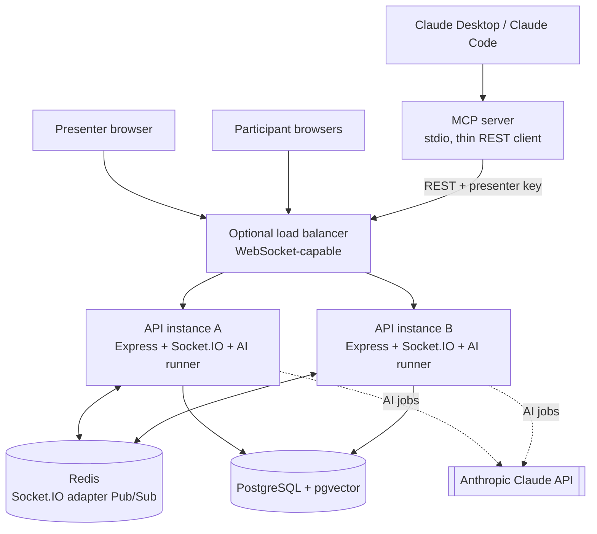
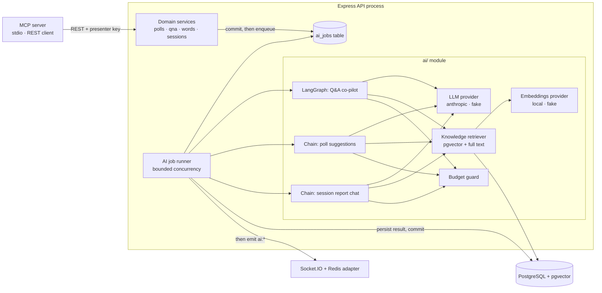

# LivePulse

LivePulse is an AI-assisted live audience engagement prototype (polls, word cloud, Q&A, and an AI co-pilot for the
presenter). Audiences join with a room code in a browser, with no app install. Every AI output is a draft until the
presenter approves it.

This is a prototype built to demonstrate product and engineering depth. It is not a production service.

## Architecture

### System diagram



### Technology stack

| Layer                    | Technology                                                       | Version (from package files)                    |
| ------------------------ | ---------------------------------------------------------------- | ----------------------------------------------- |
| Web front end            | Next.js App Router, React, Tailwind CSS                          | Next 15.5, React 19.3, Tailwind 4.3             |
| Front-end realtime       | socket.io-client                                                 | 4.8                                             |
| API                      | Node.js (20 or later), Express                                   | Express 5                                       |
| Database access          | Sequelize with PostgreSQL driver                                 | Sequelize 6.37, pg 8                            |
| Database                 | PostgreSQL 16 with pgvector                                      | `pgvector/pgvector:pg16` image                  |
| Realtime                 | Socket.IO with Redis adapter                                     | socket.io 4.8, @socket.io/redis-adapter 8.3, Redis 7 |
| Validation               | Zod (shared between API and web)                                 | Zod 3.25 (API), 3.23+ (web)                     |
| Logging                  | Pino                                                             | 9                                               |
| Security headers         | Helmet, CORS                                                     | Helmet 8                                        |
| AI orchestration         | LangChain.js core, LangGraph.js                                  | @langchain/core 1.3.0, @langchain/langgraph 1.4.21 |
| LLM                      | Anthropic Claude through @langchain/anthropic                    | 1.6.0; default model `claude-opus-5-5`          |
| Embeddings and reranking | Transformers.js with local ONNX models                           | @huggingface/transformers 4.3.1                 |
| PDF text                 | unpdf                                                            | 1.8.1                                           |
| Tool protocol            | Model Context Protocol SDK                                       | 1.32.1                                          |
| Tests                    | Vitest, Supertest, Testing Library, Playwright (installed)       | Vitest 2.1                                      |
| Local infrastructure     | Docker Compose                                                   | PostgreSQL with pgvector, Redis 7               |

Monorepo layout (npm workspaces):

```
shared/   Zod schemas, DTO types, socket event maps, constants (embedding size, emoji set)
api/      Express + Socket.IO + Sequelize + ai/ module + mcp/ entry point
web/      Next.js App Router + Tailwind
```

### Layer responsibilities

| Layer               | Does                                                                                                   | Never does                                                                 |
| ------------------- | ------------------------------------------------------------------------------------------------------ | -------------------------------------------------------------------------- |
| Next.js web         | Renders the UI; calls REST for commands and snapshots; listens to sockets                              | Decide authorisation or counts                                             |
| Express controllers | Validate input with Zod, authenticate, call a service, map errors to a standard envelope                | Hold business logic                                                        |
| Services            | Business rules, transactions, authorisation on loaded records, enqueue AI jobs in the same transaction | Emit events inside a transaction                                           |
| PostgreSQL          | Source of truth, constraints, aggregation, vector search                                               | —                                                                          |
| Socket.IO           | Low-latency fan-out of committed changes                                                               | Act as storage                                                             |
| Redis adapter       | Cross-instance broadcast                                                                               | Durable replay                                                             |
| AI module           | Reads data, calls the LLM or embeddings, saves suggestions, notifies the presenter                     | Publish to the audience without approval; run inside a request             |
| MCP server          | Exposes presenter tools by calling the REST API with the presenter key                                 | Touch the database directly or bypass API rules                            |

### Code layout

```
api/src/
  config/        environment validation (Zod), logger
  models/        Sequelize models and associations
  services/      business rules and transactions
  controllers/   request handlers
  routes/        route definitions
  validation/    Zod request schemas
  middleware/    origin check, rate limits, cookies, errors
  realtime/      socket server, handshake auth, room join, handlers, emit helpers
  ai/            providers/, embeddings/, runner.ts, tasks/, session-chat/
  knowledge/     upload and extraction worker
  mcp/           MCP server entry and tools (calls the REST API)
api/migrations/  generated migrations, each with up and down
web/src/
  app/           pages (App Router)
  components/    UI, polls, qna, word-cloud, ai, knowledge, report, sessions
  hooks/         data and realtime hooks
  lib/           API client, routes, helpers
```

### Pages

| Path                          | Who         | Purpose                                                          |
| ----------------------------- | ----------- | ---------------------------------------------------------------- |
| `/`                           | Everyone    | Landing page                                                     |
| `/host`                       | Presenter   | Create a session; shows the room code and join link              |
| `/join`                       | Participant | Enter room code and name                                         |
| `/host/[sessionId]`           | Presenter   | Live control room: polls, word cloud, Q&A, AI panel              |
| `/host/[sessionId]/knowledge` | Presenter   | Upload and manage session material                               |
| `/host/[sessionId]/report`    | Presenter   | Final report and "Ask your session"                              |
| `/room/[roomCode]`            | Participant | Participant experience: vote, word, ask, upvote                  |

### Write flow (the core rule)

Every write follows the same five steps:

1. Validate the request with Zod (HTTP and socket).
2. Authenticate the cookie or token for the session that owns the record.
3. Start a transaction and lock the rows it needs (see [Locking and concurrency](#locking-and-concurrency)).
4. Commit. If the write also needs AI, the AI job row is inserted in the same transaction.
5. After commit only, send the live update to the right room. If Redis is down, the database write still stands and
   clients reconcile by fetching over HTTP.

Votes and word answers are submitted over HTTP, not as socket commands. Sockets only announce committed changes.

### Realtime design

- Socket.IO runs on the same HTTP server at path `/api/socket.io`, using the WebSocket transport only.
- Two rooms per session: `session:<id>` (everyone in the session) and `presenter:<id>` (presenter only: AI drafts, held
  questions, AI usage).
- Handshake checks run in order: origin check, per-address and per-session connection caps, cookie authentication, then
  room join before the connection is accepted.
- Caps: 20 connections per client address and 500 per session on one instance (configurable). The presence count waits
  5 seconds after a disconnect before going down, so a page refresh does not make it flicker.
- Events (examples): `poll:started`, `poll:results`, `poll:closed`, `poll:updated`, `wordcloud:started`,
  `wordcloud:results`, `wordcloud:closed`, `wordcloud:updated`, `question:created`, `question:updated`,
  `question:upvotes`, `qna:status`, `qna:review-updated`, `qna:clusters-updated`, `poll-suggestions:ready`,
  `knowledge:document-status`, `ai:status`, `ai:usage`, `ai:job-failed`, `ai-action:updated`, `session:ended`.
- Events carry ids and small fields, not content that should stay private. For example, `knowledge:document-status` has
  no text and no file name; AI events never carry prompts or outputs.
- Reconnect: the client checks its session, then fetches the current state over HTTP. Events are idempotent by entity id
  and version.
- Redis outage: sockets stay connected, `/ready` reports `degraded`, and local clients get a `REALTIME_DEGRADED` notice.
  Redis Pub/Sub is not durable, so missed broadcasts are not replayed; the HTTP refetch covers the gap.
- Shutdown: a `SERVER_RESTARTING` notice goes to local sockets, then sockets and Redis close within 10 seconds.

### AI architecture

AI work never runs inside an HTTP request or a database transaction.



- **Job queue in PostgreSQL** (`ai_jobs`). It is the queue and the history. No separate queue service is needed. Duplicate
  requests are ignored by a unique key on active jobs.
- **Runner**: polls every second and is also nudged when a job is queued. Concurrency is bounded (default 2). Stale
  running jobs are recovered at startup and every 60 seconds. Retries use capped back-off.
- **Claiming a job**: the session row is locked first, then the job is claimed. Only one runner can win.
- **Completion is conditional**: a stale run cannot overwrite a newer one.
- **Provider selection**: `fake` (default in the example file and in all tests) or `anthropic`. The `anthropic` provider
  needs an API key and fails at startup without it. Provider errors map to fixed safe codes.
- **Structured output**: every model answer is parsed against a Zod schema. Invalid output is retried once, then the job
  fails with a safe message. Unvalidated output is never shown.
- **Untrusted text**: audience text is wrapped as data and never treated as instructions. The model has no tools that
  change state in audience-triggered flows.
- **Labelling**: everything AI-made is labelled "AI suggestion" or "AI draft". The word cloud is deterministic and is not
  called AI.
- **Models**: the default model is `claude-opus-5-5`, set by `AI_MODEL`. The embedding model is local and 384-dimensional.
- **Integration rules**: current Claude models reject sampling parameters such as temperature, and they reject forced
  tool choice. The code uses structured output with automatic tool choice.

### Vector search

- Vectors live in PostgreSQL with the pgvector extension and an HNSW index using cosine distance.
- Vectors are written and read with bound parameters only. Text and vectors are never pasted into SQL strings.
- Each query is filtered by session id first.
- Changing the embedding size needs a migration and re-embedding; the size is a constant shared by the API and the
  migrations.

## Data model

### Tables

| Table                | Purpose                                                                              | Key rules                                                                                 |
| -------------------- | ------------------------------------------------------------------------------------ | ----------------------------------------------------------------------------------------- |
| `sessions`           | Session, room code, presenter key hash, status, Q&A switch, AI switch and usage      | Room code unique; presenter key hash unique; end time set exactly when ENDED              |
| `participants`       | Audience members in a session                                                        | Token hash unique; deleted with the session                                               |
| `polls`              | Poll questions and lifecycle                                                         | At most one ACTIVE per session (partial unique index); closed time matches status         |
| `poll_options`       | 2 to 6 options per poll                                                              | Position 0 to 5; labels unique per poll                                                   |
| `votes`              | One row per participant per poll                                                     | Unique per (poll, participant); option must belong to the poll (composite foreign key)    |
| `word_prompts`       | Word-cloud prompts                                                                   | At most one ACTIVE per session                                                            |
| `word_responses`     | One answer per participant per prompt                                                | Unique per (prompt, participant)                                                          |
| `questions`          | Q&A questions, AI status, answers                                                    | At most one pinned per session; one question text per participant                         |
| `question_upvotes`   | One upvote per participant per question                                              | Unique per (question, participant); counted, not stored                                   |
| `question_clusters`  | Groups of similar questions with running centroid                                    | Created by the Q&A co-pilot                                                               |
| `ai_jobs`            | AI job queue and history                                                             | Status, attempts, token usage, model and prompt version recorded                          |
| `ai_answer_drafts`   | Drafts for presenter review                                                          | One per question; citations stored                                                        |
| `knowledge_documents`| Uploaded material metadata and status                                                | Status PROCESSING, READY or FAILED; duplicate content refused per session                 |
| `knowledge_passages` | Text chunks with 384-number embeddings                                               | Visible only to the presenter; deleted with the session                                   |
| `ai_poll_suggestions`| AI poll suggestions                                                                  | Status SUGGESTED, ACCEPTED or DISMISSED                                                   |
| `session_chat_turns` | Ask-your-session chat history                                                        | Answer limit 8,000 characters; deleted with the session                                   |
| `ai_actions`         | Proposals from MCP and their status                                                  | PROPOSED → APPROVED/REJECTED → EXECUTED/FAILED                                            |

Conventions: UUID primary keys, snake_case column names, `created_at` and `updated_at` timestamps (votes and upvotes do
not need `updated_at` because they are final). Each schema change is a generated migration with both `up` and `down`.

### Locking and concurrency

- **Lock order is always the session first, then the child row** (poll, prompt, question, job). This prevents deadlocks.
- **Voting**: the poll is locked in shared mode. Closing takes an exclusive lock on the poll, so it waits for votes in
  flight. A vote either commits before the close and is counted, or sees the poll closed and is refused.
- **Q&A cap**: the participant row is locked during submission, so five questions per participant holds under concurrency.
- **Unique constraints are the last guard.** A duplicate vote or word returns a clean conflict error, mapped outside the
  transaction.
- **Never** hold a transaction open across an LLM call, an embedding batch or a socket acknowledgement.
- Tested concurrency rules include: two simultaneous votes by one participant store exactly one vote, and a vote racing a
  poll close is either counted or refused.

### Data retention

Prototype policy: data is kept until a documented manual cleanup removes a session. Deleting a session cascades to every
child row, including passages and AI outputs. No automatic destructive job runs.

The full API endpoint list, security controls, feature status, and limitations are in the specification (sections 7, 8,
3, and 12).

## Status and documentation

| Part           | Stack                                                                                   | Status                                            |
| -------------- | --------------------------------------------------------------------------------------- | ------------------------------------------------- |
| `api/`         | Express 5, TypeScript, Sequelize, PostgreSQL, Redis, Socket.IO, Zod                     | Built (sessions, polls, word cloud, Q&A, AI, MCP) |
| `web/`         | Next.js 15, React 19, TypeScript, Tailwind CSS v4                                       | Built (host, join, presenter and audience pages)  |
| `shared/`      | Zod schemas, DTO types and realtime event contracts shared by api and web              | Built                                             |
| AI (in `api/`) | Claude via LangChain.js and LangGraph.js, RAG with pgvector, local embeddings, MCP server | Built, with a `fake` provider for offline use   |

The complete specification is in [`docs/specification/livepulse-specification.md`](docs/specification/livepulse-specification.md):
product, architecture, data model, API, realtime events, security, configuration, limitations, and testing.
The configuration file is [`.env.example`](.env.example), and every setting is explained in
[`docs/configuration/configuration-reference.md`](docs/configuration/configuration-reference.md). The numbered technical
docs are indexed in [`docs/README.md`](docs/README.md).

## Prerequisites

- Node.js 20 or newer (includes npm): `node --version`
- Docker Desktop (PostgreSQL and Redis through Docker Compose): `docker compose version`
- Git: `git --version`

## Configuration

All API settings are in one file, `.env`, created from `.env.example`. The API validates them at startup and refuses
to start if a required value is missing or invalid. The error names the setting, never its value.

1. Create your local settings file and set real local values. Never commit it:
   ```
   copy .env.example .env
   ```
   Docker Compose and the API both read `.env`. Change `POSTGRES_PASSWORD` and the password in `DATABASE_URL` together.
2. Every setting, its default, and its limits are listed in §9 of the specification.
3. The web app reads `NEXT_PUBLIC_API_URL` (default `http://localhost:4000`). Anything prefixed `NEXT_PUBLIC_` is
   public, so it must never hold a secret.

The AI defaults are safe for local use: `AI_PROVIDER=fake` and `EMBEDDINGS_PROVIDER=fake` make no network calls.
`ANTHROPIC_API_KEY` is needed only when `AI_PROVIDER=anthropic`.

## Run locally

1. Create `.env` as described above.
2. Start PostgreSQL and Redis:
   ```
   docker compose up -d
   ```
   On Windows, ports 5432 and 6379 must be free. If another local Postgres or Redis is running, stop it or change the
   host port in `docker-compose.yml`.
3. Install dependencies from the repo root:
   ```
   npm install
   ```
4. Apply database migrations:
   ```
   npm run db:migrate
   ```
5. Start the API (port 4000) in one terminal, and the web app (port 3000) in another:
   ```
   npm run dev:api
   npm run dev:web
   ```
6. Open http://localhost:3000 and check the API:
   - http://localhost:4000/health: liveness, always 200 while the process runs
   - http://localhost:4000/ready: 200 when PostgreSQL and Redis respond, 503 otherwise (`degraded` when Redis is down)

The API also refuses to start if Redis is unreachable at startup.

## Checks

```
npm run lint
npm run typecheck
npm test
```

Test layers and the critical scenarios they cover are described in §14 of the specification.

## Known limitations

These are stated in full in §12 of the specification. The main ones:

- The AI on/off switch applies per API instance, not across a cluster.
- Real-time features run on Socket.IO with a Redis adapter. Clients re-fetch over HTTP on reconnect, so Redis Pub/Sub is
  never the source of truth.
- Emoji reactions, live audience insights, the Pulse Coach, and demo seed data are planned, not built (§3 and §13).

## How we build

```
Understand → Requirement → Plan → Approve → Implement → Test → Review → Verify → Commit (human)
```

| Step                                        | Claude Code command           |
| ------------------------------------------- | ----------------------------- |
| Capture a feature as a business requirement | `/requirement <feature-name>` |
| Plan, get approval, implement, and track it | `/execute <feature-name>`     |
| Add scope to a delivered feature            | `/enhance <feature-name>`     |
| Fix a bug (test-first, approval gate)       | `/bug-fix <description>`      |
| Investigate an error from evidence          | `/debug <symptom>`            |
| Fix failing tests                           | `/fix-test <scope>`           |
| Review the diff                             | `/code-review`                |
| Run checks                                  | `/run-tests`                  |
| Ready to commit?                            | `/pre-commit-check`           |
| Understand code                             | `/explain-code <target>`      |

- Requirements: `requirements/<feature>/requirement.md` (business) and `planning-tracking.md` (technical).
- Other docs: `docs/`. See `docs/README.md`.
- Claude Code configuration: `.claude/README.md`.
