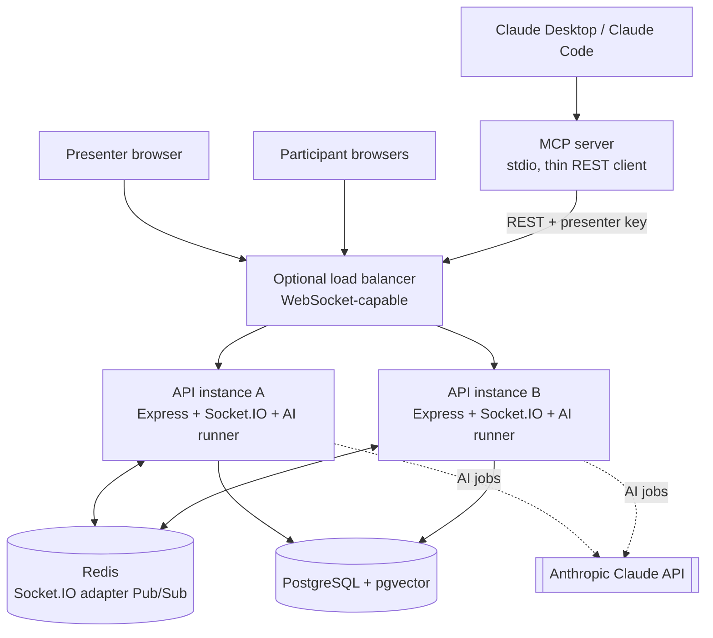

# 02 — Architecture

## 1. High-level architecture



Local development: one API instance is enough. For the multi-instance demo, run two API instances on different
ports with the same `REDIS_URL`. The MCP server is a thin client of the REST API, so its actions go through the
same validation, authorization, commit-then-emit path as the web UI.

## 2. Monorepo layout (npm workspaces)

```
shared/   Zod schemas, DTO types, socket event maps, constants (EMBEDDING_DIM, emoji set)
api/      Express + Socket.IO + Sequelize + ai/ module + mcp/ entry point
web/      Next.js App Router + Tailwind
```

```
api/src/
  config/        env validation (Zod), logger
  models/        Sequelize models + associations
  services/      business rules + transactions (sessions, polls, votes, words, qna, reactions)
  controllers/ routes/ validation/ middleware/
  realtime/      socket server, handshake auth, room join, handlers, emit helpers
  ai/            providers/ (llm, embeddings), prompts/, chains/, graphs/, retriever, job-runner, budget
  mcp/           MCP server entry + tool definitions (calls the REST API)
api/migrations/  generated, up + down
```

## 3. Responsibilities

| Layer | Does | Never does |
|---|---|---|
| Next.js | Renders UI, calls REST for commands + snapshots, listens to sockets | Decides authorization or counts |
| Express controllers | Validate (Zod), authenticate, call service, map errors to envelope | Business logic |
| Services | Rules, transactions, authorization on loaded records, enqueue AI jobs in the same transaction | Emit inside a transaction |
| Sequelize / PostgreSQL | Source of truth, constraints, aggregation, vector search | — |
| Socket.IO | Low-latency fan-out of committed changes | Act as storage |
| Redis adapter | Cross-instance broadcast | Durable replay |
| AI module | Read data, call LLM/embeddings, persist suggestions, emit to presenter | Publish to audience without approval; run in request path |
| MCP server | Expose presenter tools over stdio by calling the REST API with the presenter key | Touch the DB directly or bypass API authorization |

## 4. Write flows

### Vote
1. `vote:submit` (or REST) → validate payload, derive participant from socket/token context.
2. Transaction: lock poll row (`SELECT … FOR UPDATE`), check session ACTIVE + poll ACTIVE + option belongs to poll,
   insert vote (unique `(poll_id, participant_id)` is the final guard).
3. Commit → aggregate counts → emit `poll:results` (session room if visible, else presenter room).
4. Poll close takes the same row lock, so a vote either commits before close or is rejected — never ambiguous.

### Question (with AI)
1. `question:submit` → validate, rate limit, insert question (`VISIBLE`, or `PENDING_REVIEW` when AI moderation is
   on and moderation runs before display — see Phase 12 decision) + `ai_jobs(type=QNA_COPILOT)` in one transaction.
2. Commit → emit `question:created` (session room if visible; presenter room if pending).
3. AI runner executes the Q&A graph → persists moderation label / duplicate link / answer draft → commit → emit
   `ai:answer-draft-ready` / `question:updated` to the presenter room.
4. Presenter approves → transaction updates draft + question answer → commit → emit `question:answered` to the
   session room.

### Document ingestion
Upload (multipart, size limit) → store document row `PROCESSING` + job → runner extracts, chunks, embeds, inserts
chunks → document `READY` → emit `ai:knowledge-updated` to presenter.

## 5. Redis adapter
- `redis` + `@socket.io/redis-adapter`; separate pub/sub clients; connect before accepting traffic.
- Startup policy: **fail fast** when Redis is required (`REDIS_REQUIRED=true`, default). Degraded single-instance
  mode only via explicit config, reported in `/ready`.
- Integration test: two Socket.IO servers, one Redis; a client on B receives a room broadcast emitted on A.

## 6. Sticky sessions and transports
With HTTP long-polling behind multiple instances, sticky sessions are needed; or use WebSocket-only transport and
document the trade-off. Test the transport you actually configure.

## 7. Failure semantics

| Failure | Behaviour |
|---|---|
| PostgreSQL down | Commands fail with 503; no success broadcast; `/ready` 503 |
| Redis down | Durable writes still succeed; cross-instance fan-out degraded; logged + `/ready` reports; clients reconcile via HTTP |
| LLM down / timeout | Job retries then FAILED; presenter sees retryable AI error; core features unaffected |
| Budget exhausted | AI jobs for that session skipped with `AI_BUDGET_EXCEEDED`; presenter informed |
| Server restart | Data survives; presence recalculated; PENDING/stale RUNNING AI jobs resumed |
| Missed / duplicate / out-of-order events | Clients idempotent by entity ID + `version`/timestamp; refetch on gap |

## 8. Scaling talking points
Stateless API instances behind a WebSocket LB · Redis adapter for rooms · PostgreSQL indexes, pooling, HNSW vector
index · AI runner concurrency limits and per-session budgets · move AI runner to a separate worker process /
durable queue when load justifies it · reaction bursts aggregated server-side to protect fan-out · metrics: active
sockets, room sizes, event latency, AI job latency/failures/tokens, DB pool saturation.
