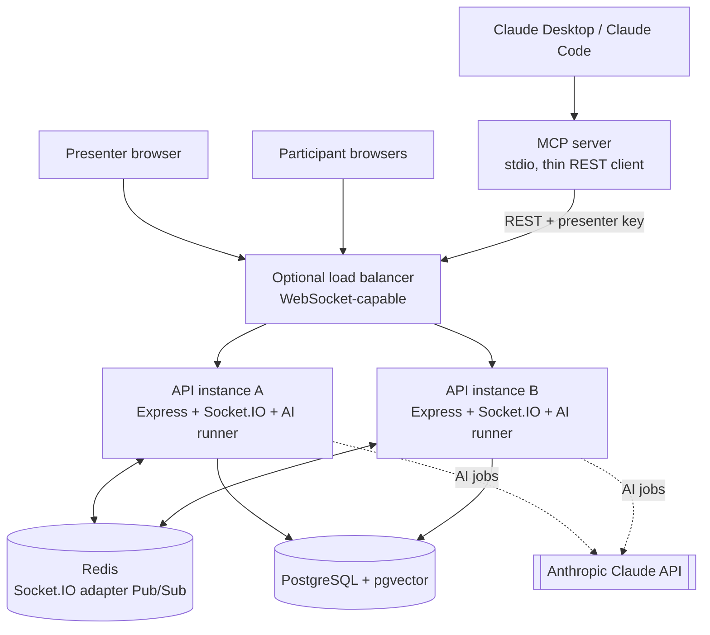

# 02 — Architecture

## 1. High-level architecture



Local development: one API instance is enough. For the multi-instance demo, run two API instances on different
ports with the same `REDIS_URL`. The MCP server is a thin client of the REST API, so its actions go through the
same validation, authorization, commit-then-emit path as the web UI.

## 2. Monorepo layout (npm workspaces)

```
shared/   Zod schemas, DTO types, socket event maps, constants (EMBEDDING_DIM, emoji set)
api/      Express + Socket.IO + Sequelize + ai/ module + mcp/ entry point
web/      Next.js App Router + Tailwind
```

```
api/src/
  config/        env validation (Zod), logger
  models/        Sequelize models + associations
  services/      business rules + transactions (sessions, polls, votes, words, qna, reactions)
  controllers/ routes/ validation/ middleware/
  realtime/      socket server, handshake auth, room join, handlers, emit helpers
  ai/            providers/ (llm, embeddings), prompts/, chains/, graphs/, retriever, job-runner, budget
  mcp/           MCP server entry + tool definitions (calls the REST API)
api/migrations/  generated, up + down
```

## 3. Responsibilities

| Layer                  | Does                                                                                          | Never does                                                |
| ---------------------- | --------------------------------------------------------------------------------------------- | --------------------------------------------------------- |
| Next.js                | Renders UI, calls REST for commands + snapshots, listens to sockets                           | Decides authorization or counts                           |
| Express controllers    | Validate (Zod), authenticate, call service, map errors to envelope                            | Business logic                                            |
| Services               | Rules, transactions, authorization on loaded records, enqueue AI jobs in the same transaction | Emit inside a transaction                                 |
| Sequelize / PostgreSQL | Source of truth, constraints, aggregation, vector search                                      | —                                                         |
| Socket.IO              | Low-latency fan-out of committed changes                                                      | Act as storage                                            |
| Redis adapter          | Cross-instance broadcast                                                                      | Durable replay                                            |
| AI module              | Read data, call LLM/embeddings, persist suggestions, emit to presenter                        | Publish to audience without approval; run in request path |
| MCP server             | Expose presenter tools over stdio by calling the REST API with the presenter key              | Touch the DB directly or bypass API authorization         |

## 4. Write flows

### Poll vote

Votes are HTTP (`POST /api/polls/:id/votes`), not socket commands.

1. Validate the body (Zod); authenticate the participant cookie for the poll's session (session id read from the poll row).
2. Transaction: lock the poll row `FOR SHARE`. Refuse DRAFT (404) and CLOSED (409 `POLL_NOT_ACTIVE`); check the option
   belongs to the poll (400 `INVALID_OPTION`); insert the vote. Concurrent votes do not block each other.
3. The unique `(poll_id, participant_id)` and the composite FK `(option_id, poll_id)` are the final guards. A duplicate
   returns 409 `VOTE_ALREADY_RECORDED`, mapped outside the transaction callback because the error aborts it.
4. Commit → schedule a combined `poll:results` send for that poll (about 250 ms). The send reads counts and
   `show_results` fresh from PostgreSQL, then picks the room (presenter room while hidden, session room when shown).
5. Close takes the poll row `FOR UPDATE`, so it waits for votes in flight: a vote either commits before the close (and is
   counted) or sees CLOSED and is refused. Never ambiguous.

### Poll lifecycle locks

- Lock order is always session row before poll row. No transaction locks a poll and then a session.
- Create: session `FOR SHARE` (waits for an end to commit), then count and insert.
- Start: session `FOR SHARE`, then poll `FOR UPDATE`. The partial unique index `polls_one_active_per_session` is the
  final guard; a second open poll returns 409 `POLL_ALREADY_ACTIVE`.
- Close and show-results switch: poll `FOR UPDATE`.
- End session: session `FOR UPDATE`, then, in the same transaction, `UPDATE polls … WHERE status = 'ACTIVE'`. The
  `closed_at` value is taken with `clock_timestamp()` after the wait for votes in flight.
- Emits happen after commit only: start → `poll:started`; close and ending a session with an open poll →
  `poll:results` then `poll:closed`; switch → `poll:updated` then `poll:results`. Vote counts are combined per poll.

### Word submit

Submissions are HTTP (`POST /api/word-prompts/:id/responses`), not socket commands.

1. Authenticate the participant cookie for the prompt's session (session id read from the prompt row) before the body is
   validated. Validate the text with Zod and normalise it (display form and key) in the service.
2. Transaction: lock the prompt row `FOR SHARE`. Refuse DRAFT (404) and CLOSED (409 `PROMPT_NOT_ACTIVE`); insert the
   response. Concurrent submissions do not block each other.
3. The unique `(prompt_id, participant_id)` is the final guard. A repeat returns 409 `WORD_ALREADY_SUBMITTED`, mapped
   outside the transaction callback because the error aborts it.
4. Commit → schedule a combined `wordcloud:results` send for that prompt (about 250 ms). The send reads the cloud and
   `show_cloud` fresh, then picks the room (presenter room while hidden, session room when shown).
5. Close takes the prompt row `FOR UPDATE`, so it waits for submissions in flight: a submission either commits before
   the close (and is counted) or sees CLOSED and is refused.

### Word prompt lifecycle locks

- Lock order is session row before prompt row, as for polls.
- Create: session `FOR SHARE`, then count and insert.
- Start: session `FOR UPDATE` (queues concurrent starts in one session), then the target prompt `FOR UPDATE`, then
  `UPDATE` the open prompt to CLOSED (waits for submissions in flight), then set the target `ACTIVE`. Opening a new
  prompt closes the previous one. The partial unique index `word_prompts_one_active_per_session` is the final guard.
- Close and show-cloud switch: prompt `FOR UPDATE`.
- End session: session `FOR UPDATE`, then, in the same transaction, `UPDATE word_prompts … WHERE status = 'ACTIVE'`
  with `clock_timestamp()`.
- Cloud counts are computed in the database: one count per normalised word, the display form is the most common
  spelling, ordered by count descending then key, top 30. Broadcast sends read the cloud fresh, never a cached copy.
- Emits happen after commit only: start → `wordcloud:results` and `wordcloud:closed` for the old prompt (if any), then
  `wordcloud:started`; close and ending a session with an open prompt → `wordcloud:results` then `wordcloud:closed`;
  switch → `wordcloud:updated` then `wordcloud:results`. Submissions are combined per prompt.

### Q&A writes (Phase 7, built)

Submit, upvote and moderation are HTTP, not socket commands. Each write commits first, then emits.

1. Submit (`POST /api/sessions/by-code/:code/questions`): the participant cookie is checked before the body is validated.
   The text is validated with Zod; the duplicate key (`text_key`) is computed in the service, never taken from the request.
2. Submit transaction: session `FOR SHARE` (409 `SESSION_ENDED`, then 409 `QNA_CLOSED` if `qna_open` is false) →
   participant `FOR NO KEY UPDATE` → count this participant's questions → insert. The five-question cap (409
   `QUESTION_LIMIT_REACHED`) relies on the participant row lock: a second submit from the same participant waits, so its
   COUNT sees the first one. `NO KEY UPDATE` does not block the key-share locks taken by foreign-key checks. The unique
   `(participant_id, text_key)` maps to 409 `QUESTION_ALREADY_ASKED`, mapped outside the transaction callback.
3. Upvote (`POST /api/questions/:id/upvotes`): session `FOR SHARE` → membership check → question `FOR SHARE` (hidden or
   unknown → 404; own question → 403) → insert into `question_upvotes`. Upvotes do not block each other. The unique
   `(question_id, participant_id)` maps to 409 `UPVOTE_ALREADY_RECORDED`, mapped outside the transaction callback.
4. Q&A switch (`PATCH /api/sessions/:id/settings`) and end: session `FOR UPDATE`. It waits for submits and upvotes in
   flight, which hold the session `FOR SHARE`, so nothing commits after a close. End also sets `qna_open = false` in the same
   transaction. Opening an ended session is refused (409 `SESSION_ENDED`).
5. Moderation (`PATCH /api/questions/:id`): session `FOR UPDATE` → question `FOR UPDATE` → updates. A pin unpins the
   session's current pinned question under the same session lock, then pins this one (the pin replaces the pin). The
   partial unique index `questions_one_pinned_per_session` is the backstop (409 `QUESTION_PIN_CONFLICT`). Hiding a pinned
   question unpins it. Moderation is allowed after the session has ended.
6. Counts are counted, not stored: each question's upvotes are `COUNT(*)` over `question_upvotes`. The list and the upvote
   `version` are read in one read-only REPEATABLE READ snapshot.
7. Emits after commit only: submit → `question:created` (re-read; skipped if hidden by then); upvote → combined
   `question:upvotes` (about 250 ms per session); moderation → `question:updated`, plus `question:upvotes` when visibility
   changed; switch and end → `qna:status`. Combined upvote updates read the counts fresh at send time, so a send after a
   hide or restore shows the current state.

### AI jobs (ai-foundation, built)

AI work never runs inside a request or a transaction. A request commits its data, then enqueues an `ai_jobs` row and nudges
the runner. Requirement: `requirements/ai-foundation/`.

- **Job queue in PostgreSQL:** `ai_jobs` is the queue and the history. Enqueue is `ON CONFLICT DO NOTHING` on the active
  `(session_id, dedupe_key)`, so a repeated request does not create a second job. No Redis queue (Redis Pub/Sub is not durable).
- **Runner (`api/src/ai/runner.ts`):** polls every second and is nudged on enqueue. Concurrency is bounded by
  `AI_MAX_CONCURRENCY`. Stale `RUNNING` rows are recovered at start and every 60 s (`RUNNER_INTERRUPTED` after the last attempt).
  Retries use capped back-off; a job ends `SUCCEEDED`, `FAILED` (safe code only) or `SKIPPED`.
- **Claim:** lock the session `FOR UPDATE`, then `UPDATE ai_jobs ... WHERE status='PENDING'`. Zero rows means another runner won.
  Lock order is always session, then job.
- **Provider selection:** `AI_PROVIDER=fake` (default in `.env.example`, used by all tests) or `anthropic` (Claude through
  `@langchain/anthropic`, `maxRetries: 0`). `anthropic` requires `ANTHROPIC_API_KEY` and fails at startup without it. Provider
  errors are mapped to fixed codes; only rate limit, unavailable, timeout and invalid output are retried.
- **Budget, reserve then settle:** at claim, the job reserves its estimate on the job row under the session lock, and budget
  in use is `ai_tokens_used` plus all reservations. When the run completes, the reservation is replaced by the actual tokens.
  Stale-run recovery refunds the reservation. Default budget is 200,000 tokens per session.
- **Completion is conditional:** `WHERE id AND status='RUNNING' AND attempts=:claimed`, so a stale run cannot overwrite a newer one.
  If AI was switched off meanwhile, the output is discarded and the job is `SKIPPED` (tokens spent are still charged).
- **Presenter-only events:** `ai:status`, `ai:usage` and `ai:job-failed` go to `presenter:<sessionId>` only, after commit.
  Payloads are built from explicit fields; no input, output or prompt text is ever sent.
- **Operator switch:** `PATCH /api/ops/ai` (header `X-Operator-Key`, compared with `timingSafeEqual`) turns AI off for all
  sessions at runtime. Turning it off cancels pending jobs and refuses new ones. Without `OPERATOR_KEY` the route answers 503.
- **Global switch (in-process):** the runtime switch is a variable inside the API process, seeded from the env default
  (`AI_ENABLED`). **Limit: it is per instance.** With two API instances, a toggle on one does not reach the other until
  the switch is moved to shared state (for example a PostgreSQL row). Single-instance only for now.
- **Vectors:** pgvector extension is enabled (migration M1). Vectors are read and written with parameterised `sequelize.query`
  only; there is no pgvector npm package. Embeddings are 384-dimensional (`EMBEDDING_DIM`).

### Question with AI (Phase 12, not built)

1. Submit → validate, rate limit, insert question (`VISIBLE`, or `PENDING_REVIEW` when AI moderation is
   on and moderation runs before display — see Phase 12 decision) + `ai_jobs(type=QNA_COPILOT)` in one transaction.
2. Commit → emit `question:created` (session room if visible; presenter room if pending).
3. AI runner executes the Q&A graph → persists moderation label / duplicate link / answer draft → commit → emit
   `ai:answer-draft-ready` / `question:updated` to the presenter room.
4. Presenter approves → transaction updates draft + question answer → commit → emit `question:answered` to the
   session room.

### Knowledge base (RAG, knowledge-base-rag, built)

Presenter only. Requirement: `requirements/knowledge-base-rag/`.

- **Upload:** `POST /api/sessions/:id/knowledge/documents` takes the raw file bytes (no multipart) and the file name in
  `X-File-Name`. `express.raw` with a 10 MB limit runs on this route only, and a Content-Length over the limit is refused
  (413) before any byte is buffered. Presenter authorisation and the upload rate limit run first. The type is checked by
  content (`%PDF-` for PDF, strict UTF-8 without NUL bytes for text) and must match the `.pdf` or `.txt` extension. A session
  holds at most 20 documents; the same content twice in one session is refused (409).
- **Extraction in a worker thread:** PDF text (`unpdf`) and text files are extracted in a worker with a 256 MB heap
  limit, a 30 s timeout (the worker is terminated) and caps of 300 pages and 2,000,000 characters. The request path never
  parses a file.
- **Background ingest:** the upload commits a `knowledge_documents` row (`PROCESSING`) and an `ai_jobs` row
  (`INGEST_DOCUMENT`, dedupe key `ingest:<documentId>`) in one transaction, then nudges the runner. The job input is only
  the document id. The task chunks the text (about 800 characters, 100 overlap, a passage never spans two pages, at most
  2,000 passages) and embeds the passages in batches of 32 with the local 384-dimension model. Extraction and embedding run
  outside any transaction. The result is committed only if the document still exists, is `PROCESSING`, and the session has
  not ended; then the stored bytes are cleared.
- **Storage (PostgreSQL):** `knowledge_documents` (original bytes in `bytea` until processed; status `PROCESSING`, `READY`
  or `FAILED` with a fixed reason) and `knowledge_passages` (`vector(384)` embedding, generated `tsvector`, page number or
  section number). Passages are never returned to anyone except the presenter.
- **Hybrid search:** `POST /api/sessions/:id/knowledge/search`. The top 50 passages by cosine distance and the top 50 by
  full-text rank are taken from the session only, combined with reciprocal rank fusion (k = 60), and the top 20 are
  reranked. The top 8 are returned. Passages below the reranker's minimum score are dropped, so a weak match is never
  invented into a result (the minimum is a constant per reranker, not an env value). The reranker is an interface: `fake`
  (token overlap, default, used by tests) or `local` (cross-encoder `Xenova/ms-marco-MiniLM-L-6-v2`; its minimum of 0.5 is
  unverified until the live test). If the reranker fails, the fused order is returned with `reranked: false`. Search does
  not need AI to be on for the session.
- **Lifecycle:** delete removes the document and its passages at once and cancels its waiting job. Ending a session deletes
  all its documents in the same transaction that ends it. A job that stops without a result shows the document as `FAILED`
  with `PROCESSING_STOPPED`.
- **Realtime:** `knowledge:document-status` goes to the presenter room only, after commit, with no text and no file name.
- **Retrieved text is data:** it is rendered as plain text and no model reads it in this phase. Phase 12 must wrap it in
  delimited, untrusted blocks before any prompt.

## 5. Socket.IO and Redis adapter

- Socket.IO on the same HTTP server, path `/api/socket.io`, websocket transport only.
- `redis` + `@socket.io/redis-adapter`; the adapter's pub/sub clients are duplicates of the command client.
  Connect all three clients before accepting traffic.
- Startup policy: **fail fast** when Redis is unreachable at startup. Once running, a Redis outage does not drop
  sockets: `/ready` returns 200 `degraded`, and each instance tells its local sockets `REALTIME_DEGRADED` /
  `REALTIME_RESTORED`. The pub client has no offline queue, so stale broadcasts are not replayed on reconnect.
- Presence is not stored: the count comes from the adapter (`fetchSockets` on the session room), so it is correct
  across instances and a crashed instance's sockets drop out by themselves.
- Handshake: origin check, per-IP and per-session caps, cookie authentication, then room join before connect.
  Details and event contracts are in `docs/05-realtime-events.md`.
- Shutdown: local `SERVER_RESTARTING` notice, then sockets and Redis are closed within 10 s.
- Integration test: two Socket.IO servers, one Redis; a client on B receives a room broadcast emitted on A.

## 6. Sticky sessions and transports

Realtime uses WebSocket-only transport (decided in phase 4). Long-polling behind multiple instances would need sticky
sessions, which are out of scope, so the trade-off is no fallback on networks that block WebSockets. Test the
transport you actually configure.

## 7. Failure semantics

| Failure                                  | Behaviour                                                                                                                                                    |
| ---------------------------------------- | ------------------------------------------------------------------------------------------------------------------------------------------------------------ |
| PostgreSQL down                          | Commands fail with 503; no success broadcast; `/ready` 503                                                                                                   |
| Redis down                               | Durable writes still succeed; sockets kept; cross-instance fan-out degraded; `/ready` 200 `degraded`; `REALTIME_DEGRADED` notice; clients reconcile via HTTP |
| LLM down / timeout                       | Job retries then FAILED; presenter sees retryable AI error; core features unaffected                                                                         |
| Budget exhausted                         | AI jobs for that session skipped with `AI_BUDGET_EXCEEDED`; presenter informed                                                                               |
| Server restart                           | Data survives; presence recalculated; PENDING/stale RUNNING AI jobs resumed                                                                                  |
| Missed / duplicate / out-of-order events | Clients idempotent by entity ID + `version`/timestamp; refetch on gap                                                                                        |

## 8. Scaling talking points

Stateless API instances behind a WebSocket LB · Redis adapter for rooms · PostgreSQL indexes, pooling, HNSW vector
index · AI runner concurrency limits and per-session budgets · move AI runner to a separate worker process /
durable queue when load justifies it · reaction bursts aggregated server-side to protect fan-out · metrics: active
sockets, room sizes, event latency, AI job latency/failures/tokens, DB pool saturation.
