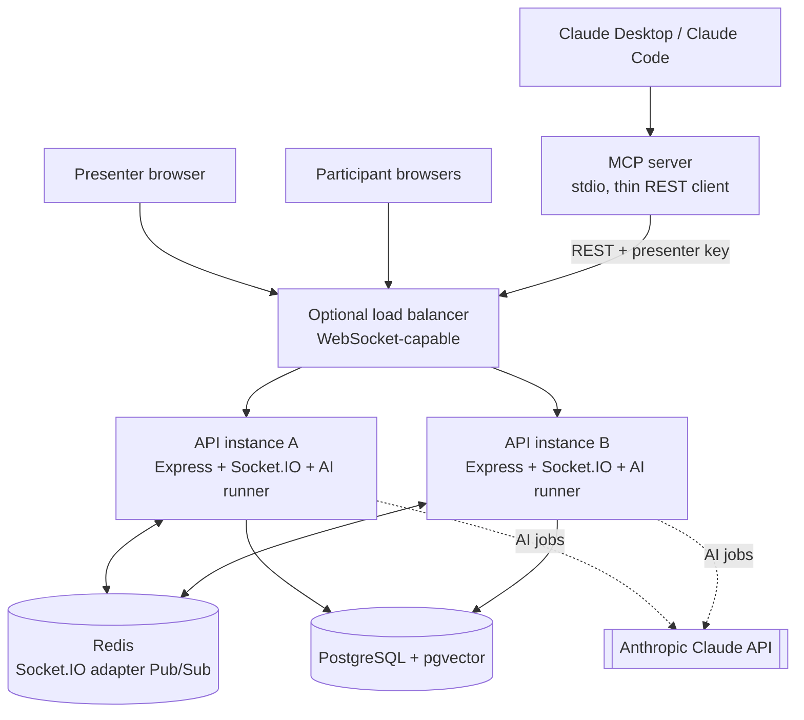

# 02 — Architecture

## 1. High-level architecture



Local development: one API instance is enough. For the multi-instance demo, run two API instances on different
ports with the same `REDIS_URL`. The MCP server is a thin client of the REST API, so its actions go through the
same validation, authorization, commit-then-emit path as the web UI.

## 2. Monorepo layout (npm workspaces)

```
shared/   Zod schemas, DTO types, socket event maps, constants (EMBEDDING_DIM, emoji set)
api/      Express + Socket.IO + Sequelize + ai/ module + mcp/ entry point
web/      Next.js App Router + Tailwind
```

```
api/src/
  config/        env validation (Zod), logger
  models/        Sequelize models + associations
  services/      business rules + transactions (sessions, polls, votes, words, qna, reactions)
  controllers/ routes/ validation/ middleware/
  realtime/      socket server, handshake auth, room join, handlers, emit helpers
  ai/            providers/ (llm, embeddings), prompts/, chains/, graphs/, retriever, job-runner, budget
  mcp/           MCP server entry + tool definitions (calls the REST API)
api/migrations/  generated, up + down
```

## 3. Responsibilities

| Layer | Does | Never does |
|---|---|---|
| Next.js | Renders UI, calls REST for commands + snapshots, listens to sockets | Decides authorization or counts |
| Express controllers | Validate (Zod), authenticate, call service, map errors to envelope | Business logic |
| Services | Rules, transactions, authorization on loaded records, enqueue AI jobs in the same transaction | Emit inside a transaction |
| Sequelize / PostgreSQL | Source of truth, constraints, aggregation, vector search | — |
| Socket.IO | Low-latency fan-out of committed changes | Act as storage |
| Redis adapter | Cross-instance broadcast | Durable replay |
| AI module | Read data, call LLM/embeddings, persist suggestions, emit to presenter | Publish to audience without approval; run in request path |
| MCP server | Expose presenter tools over stdio by calling the REST API with the presenter key | Touch the DB directly or bypass API authorization |

## 4. Write flows

### Poll vote
Votes are HTTP (`POST /api/polls/:id/votes`), not socket commands.
1. Validate the body (Zod); authenticate the participant cookie for the poll's session (session id read from the poll row).
2. Transaction: lock the poll row `FOR SHARE`. Refuse DRAFT (404) and CLOSED (409 `POLL_NOT_ACTIVE`); check the option
   belongs to the poll (400 `INVALID_OPTION`); insert the vote. Concurrent votes do not block each other.
3. The unique `(poll_id, participant_id)` and the composite FK `(option_id, poll_id)` are the final guards. A duplicate
   returns 409 `VOTE_ALREADY_RECORDED`, mapped outside the transaction callback because the error aborts it.
4. Commit → schedule a combined `poll:results` send for that poll (about 250 ms). The send reads counts and
   `show_results` fresh from PostgreSQL, then picks the room (presenter room while hidden, session room when shown).
5. Close takes the poll row `FOR UPDATE`, so it waits for votes in flight: a vote either commits before the close (and is
   counted) or sees CLOSED and is refused. Never ambiguous.

### Poll lifecycle locks
- Lock order is always session row before poll row. No transaction locks a poll and then a session.
- Create: session `FOR SHARE` (waits for an end to commit), then count and insert.
- Start: session `FOR SHARE`, then poll `FOR UPDATE`. The partial unique index `polls_one_active_per_session` is the
  final guard; a second open poll returns 409 `POLL_ALREADY_ACTIVE`.
- Close and show-results switch: poll `FOR UPDATE`.
- End session: session `FOR UPDATE`, then, in the same transaction, `UPDATE polls … WHERE status = 'ACTIVE'`. The
  `closed_at` value is taken with `clock_timestamp()` after the wait for votes in flight.
- Emits happen after commit only: start → `poll:started`; close and ending a session with an open poll →
  `poll:results` then `poll:closed`; switch → `poll:updated` then `poll:results`. Vote counts are combined per poll.

### Word submit
Submissions are HTTP (`POST /api/word-prompts/:id/responses`), not socket commands.
1. Authenticate the participant cookie for the prompt's session (session id read from the prompt row) before the body is
   validated. Validate the text with Zod and normalise it (display form and key) in the service.
2. Transaction: lock the prompt row `FOR SHARE`. Refuse DRAFT (404) and CLOSED (409 `PROMPT_NOT_ACTIVE`); insert the
   response. Concurrent submissions do not block each other.
3. The unique `(prompt_id, participant_id)` is the final guard. A repeat returns 409 `WORD_ALREADY_SUBMITTED`, mapped
   outside the transaction callback because the error aborts it.
4. Commit → schedule a combined `wordcloud:results` send for that prompt (about 250 ms). The send reads the cloud and
   `show_cloud` fresh, then picks the room (presenter room while hidden, session room when shown).
5. Close takes the prompt row `FOR UPDATE`, so it waits for submissions in flight: a submission either commits before
   the close (and is counted) or sees CLOSED and is refused.

### Word prompt lifecycle locks
- Lock order is session row before prompt row, as for polls.
- Create: session `FOR SHARE`, then count and insert.
- Start: session `FOR UPDATE` (queues concurrent starts in one session), then the target prompt `FOR UPDATE`, then
  `UPDATE` the open prompt to CLOSED (waits for submissions in flight), then set the target `ACTIVE`. Opening a new
  prompt closes the previous one. The partial unique index `word_prompts_one_active_per_session` is the final guard.
- Close and show-cloud switch: prompt `FOR UPDATE`.
- End session: session `FOR UPDATE`, then, in the same transaction, `UPDATE word_prompts … WHERE status = 'ACTIVE'`
  with `clock_timestamp()`.
- Cloud counts are computed in the database: one count per normalised word, the display form is the most common
  spelling, ordered by count descending then key, top 30. Broadcast sends read the cloud fresh, never a cached copy.
- Emits happen after commit only: start → `wordcloud:results` and `wordcloud:closed` for the old prompt (if any), then
  `wordcloud:started`; close and ending a session with an open prompt → `wordcloud:results` then `wordcloud:closed`;
  switch → `wordcloud:updated` then `wordcloud:results`. Submissions are combined per prompt.

### Question (with AI)
1. `question:submit` → validate, rate limit, insert question (`VISIBLE`, or `PENDING_REVIEW` when AI moderation is
   on and moderation runs before display — see Phase 12 decision) + `ai_jobs(type=QNA_COPILOT)` in one transaction.
2. Commit → emit `question:created` (session room if visible; presenter room if pending).
3. AI runner executes the Q&A graph → persists moderation label / duplicate link / answer draft → commit → emit
   `ai:answer-draft-ready` / `question:updated` to the presenter room.
4. Presenter approves → transaction updates draft + question answer → commit → emit `question:answered` to the
   session room.

### Document ingestion
Upload (multipart, size limit) → store document row `PROCESSING` + job → runner extracts, chunks, embeds, inserts
chunks → document `READY` → emit `ai:knowledge-updated` to presenter.

## 5. Socket.IO and Redis adapter
- Socket.IO on the same HTTP server, path `/api/socket.io`, websocket transport only.
- `redis` + `@socket.io/redis-adapter`; the adapter's pub/sub clients are duplicates of the command client.
  Connect all three clients before accepting traffic.
- Startup policy: **fail fast** when Redis is unreachable at startup. Once running, a Redis outage does not drop
  sockets: `/ready` returns 200 `degraded`, and each instance tells its local sockets `REALTIME_DEGRADED` /
  `REALTIME_RESTORED`. The pub client has no offline queue, so stale broadcasts are not replayed on reconnect.
- Presence is not stored: the count comes from the adapter (`fetchSockets` on the session room), so it is correct
  across instances and a crashed instance's sockets drop out by themselves.
- Handshake: origin check, per-IP and per-session caps, cookie authentication, then room join before connect.
  Details and event contracts are in `docs/05-realtime-events.md`.
- Shutdown: local `SERVER_RESTARTING` notice, then sockets and Redis are closed within 10 s.
- Integration test: two Socket.IO servers, one Redis; a client on B receives a room broadcast emitted on A.

## 6. Sticky sessions and transports
Realtime uses WebSocket-only transport (decided in phase 4). Long-polling behind multiple instances would need sticky
sessions, which are out of scope, so the trade-off is no fallback on networks that block WebSockets. Test the
transport you actually configure.

## 7. Failure semantics

| Failure | Behaviour |
|---|---|
| PostgreSQL down | Commands fail with 503; no success broadcast; `/ready` 503 |
| Redis down | Durable writes still succeed; sockets kept; cross-instance fan-out degraded; `/ready` 200 `degraded`; `REALTIME_DEGRADED` notice; clients reconcile via HTTP |
| LLM down / timeout | Job retries then FAILED; presenter sees retryable AI error; core features unaffected |
| Budget exhausted | AI jobs for that session skipped with `AI_BUDGET_EXCEEDED`; presenter informed |
| Server restart | Data survives; presence recalculated; PENDING/stale RUNNING AI jobs resumed |
| Missed / duplicate / out-of-order events | Clients idempotent by entity ID + `version`/timestamp; refetch on gap |

## 8. Scaling talking points
Stateless API instances behind a WebSocket LB · Redis adapter for rooms · PostgreSQL indexes, pooling, HNSW vector
index · AI runner concurrency limits and per-session budgets · move AI runner to a separate worker process /
durable queue when load justifies it · reaction bursts aggregated server-side to protect fan-out · metrics: active
sockets, room sizes, event latency, AI job latency/failures/tokens, DB pool saturation.
