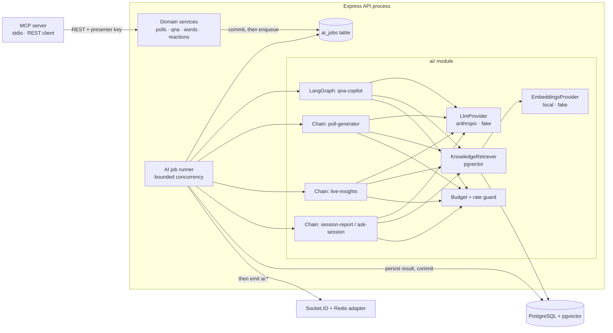
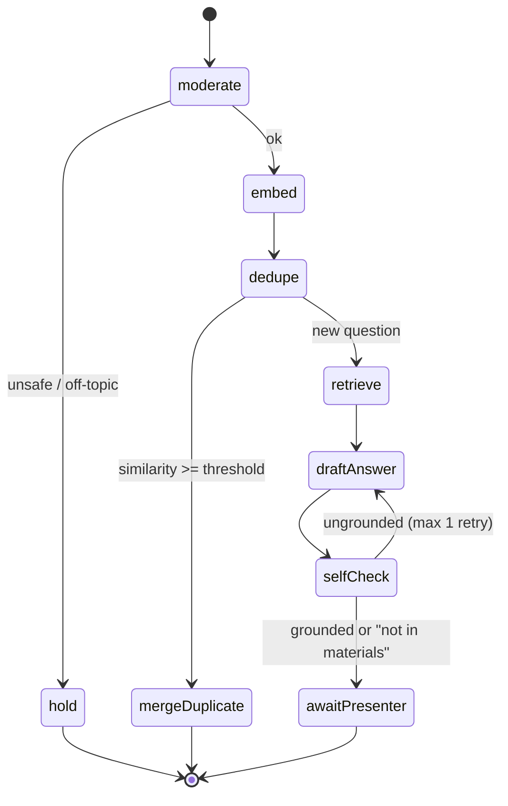

# 10 — AI Architecture (LLM · RAG · LangChain · LangGraph · pgvector · MCP)

LivePulse's differentiator is an **AI co-pilot for the presenter**. The live-engagement core (sessions, polls,
word cloud, Q&A, reactions) works without AI; the AI layer reads from it, suggests, and the presenter decides.

## 1. Principles

1. **Human in the loop.** AI never publishes to the audience by itself. It drafts (poll, answer, summary); the
   presenter approves, edits, or dismisses. Exception: moderation may *hold* a question for review.
2. **Core never depends on AI.** If the LLM is down, slow, or disabled, polls/Q&A/reactions keep working. AI
   features show "AI unavailable" and retry.
3. **PostgreSQL stays the source of truth.** Embeddings live in PostgreSQL via `pgvector` — no separate vector
   database to run, back up, or keep consistent. AI outputs are persisted before they are emitted.
4. **Async, after commit.** AI work never runs inside an HTTP request or a DB transaction. A committed write
   creates an `ai_jobs` row; a runner processes it and emits `ai:*` events when done.
5. **Structured, validated outputs.** Every LLM response is parsed against a Zod schema. Invalid output → retry
   once → job FAILED with a safe message. Never render unvalidated model output.
6. **Audience text is untrusted.** It is data inside delimited prompt sections, never instructions. The model
   never gets tools that change state on behalf of an audience member (see §8).
7. **Honest labelling.** Everything AI-generated is labelled "AI suggestion" / "AI draft" in the UI. The
   deterministic word cloud stays deterministic and is not called AI.
8. **Testable offline.** A `fake` LLM provider and deterministic embeddings make every test and an offline demo
   run with no network and no cost.

## 2. Stack choices

| Concern | Choice | Why |
|---|---|---|
| LLM | Anthropic Claude via `@langchain/anthropic` | Strong reasoning + structured output. Model ID in env (`AI_MODEL`), default `claude-opus-5-5`. |
| Optional fast model | `AI_FAST_MODEL` (open decision: same as `AI_MODEL`, or `claude-haiku-5-5` for moderation/classification) | Cheaper/faster for high-volume, simple tasks. Developer decides. |
| Orchestration | LangChain.js (`@langchain/core`) | Prompt templates, retrievers, output parsers, provider swap. |
| Agent workflows | LangGraph.js (`@langchain/langgraph`) | Explicit state machine for multi-step flows (Q&A co-pilot), conditional edges, retries, inspectable state. |
| Embeddings | Local model via Transformers.js (e.g. `all-MiniLM-L6-v2`, 384 dims), behind an `EmbeddingsProvider` interface | Free, offline, no data leaves the machine. Anthropic has no embeddings endpoint. A hosted provider can be swapped in later. |
| Vector store | PostgreSQL `pgvector` extension, HNSW index, cosine distance | One database; transactions + joins with session data; Sequelize migrations manage it. |
| Retrieval | Custom LangChain `BaseRetriever` over a parameterised Sequelize query | Keeps the "Sequelize only" rule (no second DB client/ORM such as `PGVectorStore`). |
| Tool protocol | MCP server (`@modelcontextprotocol/sdk`, TypeScript) | Lets Claude Desktop / Claude Code drive a live session with the same service layer and authorization. |
| Docker image | `pgvector/pgvector:pg16` instead of `postgres:16` | Same PostgreSQL, extension preinstalled. |

All packages above are **new dependencies** and need explicit approval when the phase that introduces them runs
(`/execute` approval gate). Pin exact versions.

### Known integration risks (verify in Phase 9 before building on them)
- Current Claude models reject `temperature` / `top_p` / `top_k` (400) and reject forced `tool_choice`
  (`any` / `tool`). Some LangChain helpers (e.g. `withStructuredOutput` in tool-calling mode) force a tool call by
  default. Use the provider's JSON-schema / structured-output mode or `tool_choice: auto`, and make sure no
  sampling params are sent. Add a smoke test that runs one real call when `AI_PROVIDER=anthropic`.
- Thinking cannot be disabled on `claude-opus-5-5`; control cost/latency with the effort setting instead.
- Changing the embedding model changes the vector dimension → migration + re-embed. Dimension is a constant in
  `shared/` and in the migration.

## 3. Component map

## 4. AI job lifecycle

1. A domain event commits (question submitted, document uploaded, presenter clicks "Suggest polls").
2. The service inserts `ai_jobs(type, session_id, input, status=PENDING)` in the same transaction.
3. After commit, the runner is nudged (in-process). On startup it also picks up PENDING/stale RUNNING jobs, so a
   restart does not lose work.
4. Runner claims the job (`UPDATE … SET status='RUNNING' WHERE id=? AND status='PENDING'` — one claimer wins),
   checks the session budget, runs the chain/graph, validates output with Zod.
5. Result rows (`ai_poll_suggestions`, `ai_answer_drafts`, `ai_insights`, …) and job status `SUCCEEDED` are
   written in one transaction, with token usage and model ID recorded on the job.
6. After commit, emit the matching `ai:*` event to the **presenter room only** (or session room for approved
   content).
7. On failure: retry with backoff up to `AI_MAX_ATTEMPTS`, then `FAILED` with a safe error code; emit
   `ai:job-failed` to the presenter.

A durable queue (e.g. BullMQ on Redis) is a documented future option; for the prototype the PostgreSQL job table
is enough and keeps one source of truth.

## 5. Features

### 5.1 Knowledge base (RAG ingestion) — Phase 10
- Presenter uploads slides/notes: PDF, Markdown, or plain text (size and page limits enforced).
- Pipeline: extract text → normalise → chunk (~500–800 tokens, ~15% overlap, keep page/heading metadata) →
  embed in batches → store `knowledge_chunks(content, embedding, page, heading)` → document `READY`.
- Retrieval is **hybrid** (see §5.7A): pgvector cosine top-20 and PostgreSQL full-text top-20, both **filtered by
  `session_id`**, fused with Reciprocal Rank Fusion, then reranked to top-5. Minimum similarity threshold applies;
  return chunks with citation metadata.
- No match above threshold → the AI must say it does not know (no fabrication).

### 5.2 AI poll generator — Phase 11 (LangChain chain)
- Input: presenter topic/instruction + retrieved chunks + recent Q&A themes.
- Output (Zod): 1–3 polls, each `{ question, options[2–6], rationale, sourceChunkIds[] }`.
- Presenter sees suggestions, can edit, then "Create poll" → normal poll (DRAFT) via the existing poll service.
- Optional: quiz mode with a marked correct option (only if requested in the requirement).

### 5.3 AI Q&A co-pilot — Phase 12 (LangGraph)
State machine run per submitted question:

- **moderate**: classify `{ label: OK | TOXIC | SPAM | OFF_TOPIC | PII, reason }`. Not OK → question status
  `PENDING_REVIEW`, visible only to presenter, who can release or reject.
- **dedupe**: nearest existing question in the session by embedding; above threshold → link as duplicate, its
  upvote goes to the canonical question; the participant sees "Similar question already asked — upvoted it".
- **retrieve + draftAnswer**: grounded answer with citations to chunks; confidence score.
- **selfCheck**: verifies every claim is supported by the cited chunks; otherwise retry once or answer
  "Not covered in the materials".
- **awaitPresenter**: persisted `ai_answer_drafts(status=PENDING_REVIEW)`. The presenter approves (optionally
  edited) → answer published to the room. Durability comes from the table, not from in-memory graph state, so
  approvals survive restarts.

### 5.4 Live audience insights — Phase 13
- **Semantic word themes**: cluster word-cloud responses by embedding similarity ("collab", "teamwork",
  "working together" → one theme), LLM names each theme. Shown next to (not instead of) the exact-count cloud.
- **Sentiment pulse**: classify recent responses/questions + reaction mix into a rolling room mood
  (positive/neutral/confused/negative) with a short reason.
- **Room summary on demand**: "What is the room thinking right now?" → 3–5 bullets with evidence counts.
- Debounced: recompute at most every `AI_INSIGHTS_INTERVAL_SECONDS` and only when new input arrived.

### 5.5 Post-session report + "Ask your session" — Phase 14
- After a session ends: report with key takeaways, poll outcomes, top questions (answered/unanswered), themes,
  sentiment timeline, suggested follow-ups. Numbers come from SQL aggregates, the LLM only writes narrative
  around them (no invented numbers).
- "Ask your session": presenter chat over session data (questions, responses, poll results, knowledge chunks)
  using RAG; answers streamed to the browser (SSE or socket chunks) with citations.

### 5.6 MCP server — Phase 15
A separate entry point (`api/src/mcp/`) over stdio exposing presenter tools. Each tool is a thin call to the
LivePulse REST API with the presenter key, so authorization, validation, and emit-after-commit rules are
identical to the web UI and there is no second write path. Tool inputs are Zod-validated (shared schemas).

| Tool | Effect |
|---|---|
| `list_my_sessions` | Sessions the presenter key can access |
| `get_session_snapshot` | Status, participant count, active poll, results, top questions |
| `create_poll` / `start_poll` / `close_poll` | Same rules as REST; audience sees it live |
| `suggest_polls` | Runs the poll generator, returns suggestions |
| `list_questions` / `approve_answer` | Read Q&A, publish an approved draft |
| `get_insights` / `get_session_report` | Read latest AI insights/report |

Resources: `livepulse://session/{id}/snapshot`. Config via env in the Claude Desktop MCP entry:
`LIVEPULSE_API_URL`, `LIVEPULSE_PRESENTER_KEY` (one session per key). Demo: in Claude Desktop, "create a poll about pricing in my session" → audience phones update
live.

### 5.7 Differentiators — what makes this more than a chatbot

Each item maps to a phase and a behaviour that can be tested or measured. Model routing for all of them: Opus 5.5
(`AI_MODEL`) for reports, poll generation, answer drafts and the ask-session chat; the fast model (`AI_FAST_MODEL`,
proposed `claude-haiku-5-5`) for moderation, language detection and cluster labels. Effort is set per route.

**A. Hybrid retrieval with reranking (Phase 10).** Pure vector search misses exact terms: product names, prices,
slide titles, codes. Retrieval runs two queries in parallel — pgvector cosine top-20 and PostgreSQL full-text
(`tsvector` with a GIN index, `ts_rank`) top-20 — both scoped to `session_id`. Results are fused with Reciprocal
Rank Fusion (`score = Σ 1 / (60 + rank)`). A local cross-encoder reranker (ONNX model via Transformers.js; the
exact model is confirmed in the Phase 10 plan) scores the fused top-20 and keeps five. Quality is measured as
recall@5 on labelled fixtures, hybrid versus vector-only (§9).

**B. Live question clusters (Phase 12).** Each new question joins the nearest cluster centroid above a similarity
threshold, or starts a new cluster. Centroids are kept as running means on `question_clusters`. Each cluster has
an LLM-written label ("Pricing for small teams — 12 questions"). The presenter sees clusters sorted by size and can
answer a whole cluster with one approved draft. Duplicate merging (§5.3) is the tight case of this; clusters are
the wider view for the presenter.

**C. Pulse Coach (Phase 13).** A presenter-only advisor watching live signals: a spike in 🤔 reactions, a cluster
growing fast, a poll that splits close to 50/50, or confusion-type themes in word responses. Triggers are
deterministic rules, so they are cheap and testable. The LLM only writes the suggestion, for example "40% of the
room is asking about pricing — a 60-second recap slide, or a poll on which plan they are considering?".
Suggestions are dismissable and never act on their own. What the coach suggested and what the presenter did is
logged, so the report can cover it.

**D. Multilingual audience (Phase 12).** A participant asks in any language. The fast model detects the language
and translates the question into the presenter's language. The presenter answers in their own language, and the
answer is shown back in the asker's language. The original text is always kept and can be shown on request.

**E. Approval-gated actions for Claude and the in-app assistant (Phase 15).** Every write an AI makes is a
proposal, not an action. Claude (via MCP) or the in-app assistant calls `propose_*` tools (create poll, start poll,
close poll, publish answer). Each proposal is stored in `ai_actions` (`PROPOSED → APPROVED | REJECTED → EXECUTED |
FAILED`) and appears in the presenter's AI panel. Executing an approved action calls the same REST service as the
web UI. Read-only tools run without approval. For multi-step plans ("after the pricing question, run a poll on plan
choice, then close it after two minutes"), a LangGraph graph pauses at an interrupt node until each step is
approved. Pending state lives in PostgreSQL, so approvals survive a restart. Checkpointing with
`@langchain/langgraph-checkpoint-postgres` is an option to decide in the Phase 15 plan; the default is our own
`ai_actions` table, which needs no extra package.

**F. Tool-using "Ask your session" (Phase 14).** Instead of stuffing everything into one prompt, the model gets a
small set of strict, read-only tools: `get_poll_results`, `search_questions`, `get_word_themes`,
`search_materials`. The server binds every tool to the presenter's session; the model cannot pass a session ID.
Answers cite tool results. Each tool call is recorded on the job. Tools use strict JSON schemas and `tool_choice:
auto` (current models reject forced tool use).

## 6. Prompt management
- Prompts live in code as versioned templates (`api/src/ai/prompts/<name>.v1.ts`), not in the DB.
- Each job records `prompt_version` and `model` for traceability.
- System prompt states the role, the delimiting convention for untrusted text (`<audience_input>…</audience_input>`),
  the output schema, and "say you don't know when sources don't cover it".
- Keep the stable prefix first (system + instructions) so prompt caching can apply.

## 7. Cost, latency, and limits
- Per-session token budget (`AI_SESSION_TOKEN_BUDGET`) checked before every call; exceeded → feature pauses with
  a clear presenter message.
- Global kill switch `AI_ENABLED=false`; per-session toggle by the presenter.
- Bounded runner concurrency (`AI_MAX_CONCURRENCY`) and per-session job dedupe (no two insight jobs queued).
- Timeouts on every LLM call; streaming for long outputs (report, ask-session).
- Usage (input/output tokens, latency) stored on `ai_jobs` and visible on a small presenter "AI usage" panel.

## 8. AI security (summary — details in 06)
- Prompt injection: audience text delimited and labelled untrusted; the model gets no state-changing tools in
  audience-triggered flows; outputs are schema-validated and rendered as text.
- Data minimisation: send display names to the LLM only when needed (default: omit them).
- Secrets: `ANTHROPIC_API_KEY` only from env, never logged, never sent to the browser.
- Disclosure: presenter enables AI per session and sees "audience text is sent to an external AI provider" when
  `AI_PROVIDER=anthropic`.

## 9. Evaluation
- Golden set in `api/tests/ai/fixtures/`: ~20 questions with expected grounded/ungrounded outcome, ~10 duplicate
  pairs, ~10 moderation cases, 3 documents.
- Automated checks (fake provider in CI): graph routing, schema validation, threshold logic, retrieval ranking.
- Manual/opt-in eval run with the real model (`npm run eval:ai`, needs approval because it costs money): report
  groundedness, duplicate-detection precision, moderation accuracy. Never claim scores that were not measured.
- RAG metrics on the golden set: retrieval recall@5 (hybrid vs vector-only), faithfulness and answer relevance
  (LLM judge with a fixed rubric), cluster purity on labelled questions, language-detection accuracy. Each run
  records model, prompt version and date.
