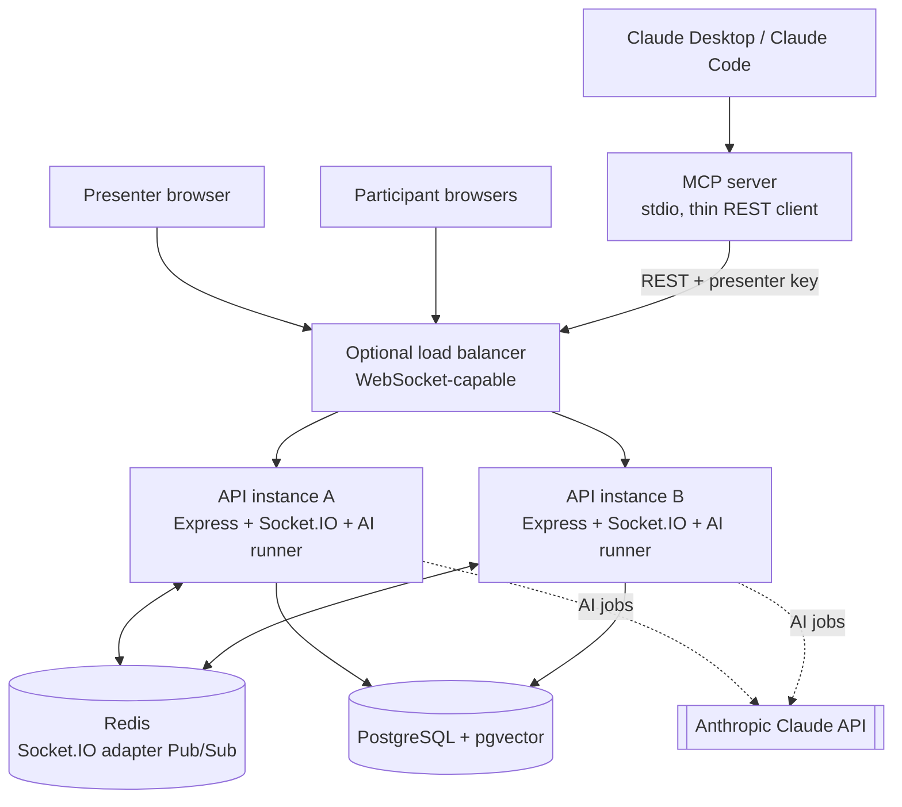
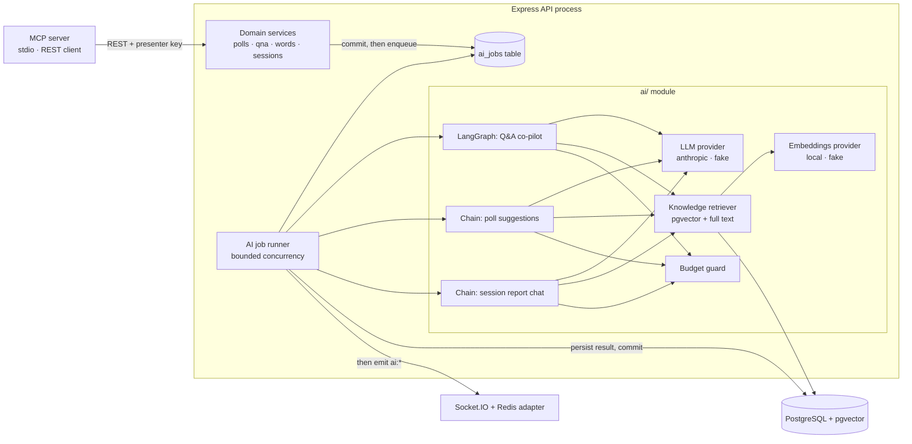

# LivePulse — Complete Product, Architecture and Specification Guide (English)

Version: prototype · Date: 2026-10-27 · Audience: company demo, HR, engineering, leadership

This document explains what LivePulse does, what is built today, how it is designed, how it is configured, and what limits
apply. It describes the code as it exists in the repository. Items that are planned but not built are marked clearly.

---

## 1. What LivePulse is

LivePulse is a real-time audience engagement web app. A **presenter** runs a live session (for example, a talk, a
training or a town hall). The **audience** joins from any phone or laptop browser with a short room code, with no account
and no app install. They answer polls, submit words for a word cloud, ask and upvote questions, and everything updates on
every screen live.

On top of this engagement core, LivePulse has an **AI co-pilot for the presenter**. The AI reads the presenter's own
material (slides, PDFs, notes), suggests polls, moderates and merges duplicate questions, drafts answers with citations,
and writes a post-session report. The AI never publishes anything to the audience by itself. The presenter always
approves.

Design promises:

1. **The core works without AI.** If AI is off, slow, or the model provider is down, polls, word cloud and Q&A keep working.
2. **Human in the loop.** AI produces suggestions and drafts. The presenter approves, edits or dismisses them.
3. **One source of truth.** PostgreSQL holds all data, including the AI embeddings (through the pgvector extension).
4. **Commit first, then announce.** Every change is saved to the database before any live update is sent.
5. **Everything testable offline.** A `fake` AI provider and a deterministic embedding provider let the whole system run
   with no internet and no cost.

---

## 2. Users and roles

| Role | Who | What they can do |
| --- | --- | --- |
| Presenter (host) | The person running the session | Create the session, run polls and word-cloud prompts, manage Q&A, upload material, review AI suggestions, end the session, read the report, ask the session questions |
| Participant (audience) | Anyone with the room code | Join with a display name, vote, submit one word per prompt, ask up to five questions, upvote others' questions |
| AI co-pilot (system actor) | The AI running on the server | Drafts and holds only. Never publishes. Acts only inside one session |
| Evaluator / reviewer | Engineers, CTO, HR | Runs the app locally, reads the docs, runs tests |

Identity model: there are no user accounts. The presenter receives a **presenter key** once, at session creation. It is
stored only as a hash on the server. Participants receive an **opaque participant token** when they join. Both are kept in
HttpOnly cookies, one cookie per session and role.

---

## 3. Feature status (honest summary)

| # | Feature | Status | Where it lives |
| --- | --- | --- | --- |
| 1 | Landing, host, join pages | Built | Web: `/`, `/host`, `/join` |
| 2 | Session creation, room code, presenter key | Built | API sessions, controller and service |
| 3 | Real-time backbone (Socket.IO + Redis adapter, presence, reconnect) | Built | API `realtime/`, web realtime hooks |
| 4 | Live polls (DRAFT → ACTIVE → CLOSED, one vote each, live results) | Built | Polls routes and services |
| 5 | Word cloud (one word per participant per prompt, live cloud) | Built | Word-prompt routes and services |
| 6 | Live Q&A (questions, upvotes, moderation, pin, hide, answered) | Built | Question routes and services |
| 7 | AI foundation (job queue, runner, budget, kill switch, providers) | Built | `api/src/ai/` |
| 8 | Knowledge base / RAG (upload PDF or text, chunk, embed, hybrid search) | Built | `knowledge/`, knowledge routes and page |
| 9 | AI poll generator (grounded poll suggestions → create poll) | Built | Poll-suggestions routes and task |
| 10 | AI Q&A co-pilot (LangGraph: moderate, dedupe, retrieve, draft, self-check, approval) | Built | `api/src/ai/tasks/qna-copilot/` |
| 11 | Question clusters | Built | `question_clusters` table, `qna/clusters` route |
| 12 | Post-session report and streamed "Ask your session" chat | Built | Session-report routes, `ai/session-chat/` |
| 13 | MCP server for Claude Desktop / Claude Code (8 tools) | Built | `api/src/mcp/` |
| 14 | AI action approval panel (proposals from MCP appear for presenter approval) | Built | `ai_actions` table, AI panel in web |
| 15 | Operator kill switch for AI | Built (per instance, see §12) | `PATCH /api/ops/ai` |
| 16 | Emoji reactions with throttled bursts and per-minute counts | **Planned, not built** | Phase 8 |
| 17 | Live audience insights (semantic word themes, sentiment pulse, room summary) | **Planned, not built** | Phase 13 |
| 18 | Pulse Coach (presenter advisor from live signals) | **Planned, not built** | Phase 13 |
| 19 | Demo seed data and two-instance demo script | **Planned, not built** | Phase 17 |

Automated tests are described in §14.

---

## 4. Feature walkthrough

### 4.1 Session and join

- The presenter enters a title (up to 80 characters) and an optional description (up to 500 characters).
- The server creates a **room code** of 6 characters from a 31-character alphabet with no look-alike characters
  (for example, no `0`/`O` or `1`/`I`). Collisions are retried with a bounded loop.
- The presenter key is shown once. The session page shows the room code and the join link, each with a copy button.
- A participant opens the join link or types the code, enters a display name (up to 30 characters), and receives a token.
  Refreshing the page reuses the stored token.
- The room code is discovery only. It never grants presenter rights.
- A session has two states: ACTIVE and ENDED. Ending a session makes everything read-only, closes any open poll, prompt
  or Q&A, deletes uploaded knowledge documents, and sets the end time in the same database transaction.
- Presence (how many people are connected) is live and is not stored as a count. It comes from Socket.IO, so it is
  correct across instances.

### 4.2 Live polls

- The presenter writes a question (up to 200 characters) and 2 to 6 options (up to 80 characters each). Duplicate option
  labels are refused, ignoring letter case.
- Lifecycle: **DRAFT** (editable, hidden) → **ACTIVE** (accepting votes) → **CLOSED** (final, immutable).
- Only one poll can be ACTIVE per session at a time. A database rule enforces this.
- Each participant votes once per poll. The database refuses a second vote, even under heavy concurrency.
- Votes are counted in PostgreSQL. Results are sent to the room about 250 ms after the vote, combined per poll.
- The presenter decides whether participants can see results (`show_results`). Hidden results are enforced on the server,
  not just in the browser.
- Closing a poll and voting are serialised by a row lock, so a vote either counts before the close or is refused. Nothing
  is ambiguous.

### 4.3 Word cloud

- The presenter opens a prompt (question up to 200 characters), starts it, and closes it later.
- Each participant can submit one word or short phrase per prompt (display form up to 30 characters).
- Words are normalised for counting: whitespace collapsed and lower-cased for the key, with the most common spelling kept
  for display.
- The cloud shows the top 30 terms, ordered by count and then by key. Counts are computed in the database.
- The exact-count cloud is deterministic and is **not AI**. AI themes are planned separately (§3, item 17).

### 4.4 Live Q&A

- Participants submit questions (up to 200 characters). Each participant can ask at most **five** questions per session.
- The same participant cannot ask the same question twice (the key is computed on the server).
- Participants upvote others' questions, once each. Nobody can upvote their own question.
- The list is ordered by upvotes (highest first), then oldest first. Upvote counts are counted from the upvote table,
  not stored as a number, which avoids contention when many people vote at once.
- The presenter can:
  - mark a question answered (with an answer of up to 500 characters),
  - hide a question (hidden questions are never shown to the room),
  - pin one question at a time (the database allows only one pinned question per session),
  - turn Q&A on or off for the room.
- Ending the session sets Q&A to closed. Moderation is still allowed after the end.

### 4.5 Knowledge base (RAG)

- The presenter uploads a **PDF** or a **plain text** file (10 MB maximum). Up to **20 documents** per session. The same
  file content cannot be uploaded twice in one session.
- The file type is checked by its content, not only its name.
- Text extraction runs in a separate worker thread with a 256 MB memory cap, a 30-second timeout and limits of 300 pages
  and 2,000,000 characters. The web request never parses the file.
- Text is split into passages of about 800 characters with 100 characters of overlap. A passage never spans two pages.
  Each passage is turned into a 384-number vector (an embedding) by a local model. No file content leaves the machine
  when the local embeddings provider is used.
- Passages are stored in PostgreSQL. They are visible only to the presenter and are deleted when the session ends.
- **Hybrid search**: the presenter searches the material. The system combines a vector (meaning) search and a keyword
  (exact term) search, merges the two lists, reranks the best candidates, and returns the top 8. Weak matches below a
  minimum score are dropped, so the system does not invent an answer from nothing.
- Retrieved text is treated as data and rendered as plain text.

### 4.6 AI poll generator

- The presenter asks for poll suggestions. The AI reads relevant passages from the session's material.
- The output is validated against a schema: each suggestion has a question, 2 to 6 options, a short rationale and the
  source passage ids.
- Suggestions are labelled as AI suggestions. The presenter can edit one and create a normal DRAFT poll from it. Nothing
  reaches the audience until the presenter starts the poll.
- Rate limit: 6 requests per minute per session.

### 4.7 AI Q&A co-pilot (LangGraph)

Each new question starts one AI job that runs a small state machine with these steps:

1. **moderate**: classifies the question as OK, TOXIC, SPAM, OFF_TOPIC or PII, and detects its language. A question that is
   not OK is **held**: only the presenter sees it.
2. **embed**: turns the question (in English) into a vector.
3. **dedupe**: if the question is at least 90% similar to an existing one (configurable), it is **merged** into the
   original, and the asker's upvote moves to the original. Otherwise it joins the nearest cluster (75% similarity) or
   starts a new one.
4. **retrieve**: finds passages from this session's material only. If there are none, the answer is "Not covered in the
   materials", with no model call.
5. **draft**: writes a short answer (at most 500 characters, one line, plain text) with at most three citations. It is
   grounded or marked not covered. It may retry once if the citations are missing.
6. **selfCheck**: a separate AI call checks every claim against the cited passages. An unsupported draft is redrafted (at
   most two attempts) and then marked not covered. The presenter can never approve a draft that failed the check.
7. **awaitPresenter**: the draft waits in the presenter's review panel. Nothing is shown to the room.

Presenter approval: the presenter may edit the draft (up to 500 characters) and approve it. Only the approved text is
saved as the answer, with citations reduced to the document name and location. The room receives a notice and reloads
the answer over HTTP. No draft text travels over the socket.

Fail-open behaviour: if AI is off, over budget or unavailable when a question arrives, the question is shown at once and no
AI job runs. If a run fails permanently, the question is released to the room, and the presenter can still hide it.

### 4.8 Post-session report and "Ask your session"

- **The report is computed from the database**, not written by AI. It shows poll results, top word-cloud terms, question
  counts, top-upvoted questions, knowledge document ingest counts and AI usage. The report can be exported as JSON.
  Numbers always come from SQL, so the model never produces them.
- **"Ask your session"** is a chat for the presenter. Each question builds a snapshot of the session. The model can call
  only four read-only tools (poll results, search questions, word themes, search materials). The tools are bound to the
  presenter's session by the server, so the model cannot reach another session. A turn is limited to 4 tool rounds and 45
  seconds. Answers are streamed over Server-Sent Events on the presenter's own request. Each answer cites tool results, and
  the server, not the model, decides the source labels.
- Each chat turn reserves tokens (8,000 by default) against the session budget and settles with the real usage.
- Chat stays available after the session ends when AI was on during the session.

### 4.9 MCP server (Claude Desktop and Claude Code)

- A separate program (`npm run mcp -w api`) speaks the Model Context Protocol over standard input and output.
- It is a **thin client of the REST API**. It holds no database connection and has no second write path, so the same
  validation, authorisation and commit-then-announce rules apply.
- Tools:

| Tool | Type | Effect |
| --- | --- | --- |
| `get_session_snapshot` | Read | Session state, polls, top questions, recent AI actions |
| `suggest_polls` | Read | Runs the poll generator and returns suggestions |
| `list_questions` | Read | Visible questions (at most 50) |
| `get_session_report` | Read | The session report |
| `propose_create_poll` | Proposal | Stores a pending CREATE_POLL action |
| `propose_start_poll` | Proposal | Stores a pending START_POLL action |
| `propose_close_poll` | Proposal | Stores a pending CLOSE_POLL action |
| `propose_publish_answer` | Proposal | Stores a pending PUBLISH_ANSWER action |

- Proposals are stored with status `PROPOSED` in the `ai_actions` table and appear in the presenter's AI panel. They run only
  after the presenter approves. Statuses: PROPOSED → APPROVED or REJECTED → EXECUTED or FAILED.
- Configuration is in the Claude Desktop MCP entry: API URL, session id and presenter key (one session per key).

### 4.10 AI controls

- Global kill switch: the environment variable `AI_ENABLED` (default true in the example file).
- Per-session toggle: the presenter can switch AI on or off for one session.
- Operator switch: `PATCH /api/ops/ai`, protected by a header key of at least 32 characters. Turning AI off cancels pending
  jobs and refuses new ones. Without an operator key configured, this route answers 503.
- Token budget per session (default 200,000 tokens). A job reserves its estimate before it runs and settles with the real
  usage afterwards.
- An AI usage panel shows tokens and job status to the presenter.

### 4.11 Planned features (not built)

- **Emoji reactions** (👍 ❤️ 😂 😮 👏 🤔): a fixed set, rate limited, sent as bursts about every 500 ms and stored as
  per-minute counts, not one row per tap.
- **Live audience insights**: semantic themes over word-cloud answers, a sentiment pulse, and an on-demand room summary,
  refreshed no more often than a configured interval.
- **Pulse Coach**: a presenter-only advisor using deterministic triggers (for example, a poll that splits close to 50/50),
  with an LLM only writing the suggestion. Suggestions never act on their own.
- **Demo seed data** and a two-instance demo script.

---

## 5. Architecture

### 5.1 High-level diagram



### 5.2 Technology stack

| Layer | Technology | Version (from package files) |
| --- | --- | --- |
| Web front end | Next.js App Router, React, Tailwind CSS | Next 15.5, React 19.3, Tailwind 4.3 |
| Front-end realtime | socket.io-client | 4.8 |
| API | Node.js (20 or later in engines field), Express | Express 5 |
| Database access | Sequelize with PostgreSQL driver | Sequelize 6.37, pg 8 |
| Database | PostgreSQL 16 with pgvector | `pgvector/pgvector:pg16` image |
| Realtime | Socket.IO with Redis adapter | socket.io 4.8, @socket.io/redis-adapter 8.3, Redis 7 |
| Validation | Zod (shared between API and web) | Zod 3.25 (API), 3.23+ (web) |
| Logging | Pino | 9 |
| Security headers | Helmet, CORS | Helmet 8 |
| AI orchestration | LangChain.js core, LangGraph.js | @langchain/core 1.3.0, @langchain/langgraph 1.4.21 |
| LLM | Anthropic Claude through @langchain/anthropic | 1.6.0; default model `claude-opus-5-5` |
| Embeddings and reranking | Transformers.js with local ONNX models | @huggingface/transformers 4.3.1 |
| PDF text | unpdf | 1.8.1 |
| Tool protocol | Model Context Protocol SDK | 1.32.1 |
| Tests | Vitest, Supertest, Testing Library, Playwright (installed) | Vitest 2.1 |
| Local infrastructure | Docker Compose | PostgreSQL + pgvector, Redis 7 |

Monorepo layout (npm workspaces):

```
shared/   Zod schemas, DTO types, socket event maps, constants (embedding size, emoji set)
api/      Express + Socket.IO + Sequelize + ai/ module + mcp/ entry point
web/      Next.js App Router + Tailwind
```

### 5.3 Layer responsibilities

| Layer | Does | Never does |
| --- | --- | --- |
| Next.js web | Renders the UI; calls REST for commands and snapshots; listens to sockets | Decide authorisation or counts |
| Express controllers | Validate input with Zod, authenticate, call a service, map errors to a standard envelope | Hold business logic |
| Services | Business rules, transactions, authorisation on loaded records, enqueue AI jobs in the same transaction | Emit events inside a transaction |
| PostgreSQL | Source of truth, constraints, aggregation, vector search | — |
| Socket.IO | Low-latency fan-out of committed changes | Act as storage |
| Redis adapter | Cross-instance broadcast | Durable replay |
| AI module | Reads data, calls the LLM or embeddings, saves suggestions, notifies the presenter | Publish to the audience without approval; run inside a request |
| MCP server | Exposes presenter tools by calling the REST API with the presenter key | Touch the database directly or bypass API rules |

### 5.4 Code layout

```
api/src/
  config/        environment validation (Zod), logger
  models/        Sequelize models and associations
  services/      business rules and transactions
  controllers/   request handlers
  routes/        route definitions
  validation/    Zod request schemas
  middleware/    origin check, rate limits, cookies, errors
  realtime/      socket server, handshake auth, room join, handlers, emit helpers
  ai/            providers/, embeddings/, runner.ts, tasks/, session-chat/
  knowledge/     upload and extraction worker
  mcp/           MCP server entry and tools (calls the REST API)
api/migrations/  generated migrations, each with up and down
web/src/
  app/           pages (App Router)
  components/    UI, polls, qna, word-cloud, ai, knowledge, report, sessions
  hooks/         data and realtime hooks
  lib/           API client, routes, helpers
```

### 5.5 Pages

| Path | Who | Purpose |
| --- | --- | --- |
| `/` | Everyone | Landing page |
| `/host` | Presenter | Create a session; shows the room code and join link |
| `/join` | Participant | Enter room code and name |
| `/host/[sessionId]` | Presenter | Live control room: polls, word cloud, Q&A, AI panel |
| `/host/[sessionId]/knowledge` | Presenter | Upload and manage session material |
| `/host/[sessionId]/report` | Presenter | Final report and "Ask your session" |
| `/room/[roomCode]` | Participant | Participant experience: vote, word, ask, upvote |

### 5.6 Write flow (the core rule)

Every write follows the same five steps:

1. Validate the request with Zod (HTTP and socket).
2. Authenticate the cookie or token for the session that owns the record.
3. Start a transaction and lock the rows it needs (see §6).
4. Commit. If the write also needs AI, the AI job row is inserted in the same transaction.
5. After commit only, send the live update to the right room. If Redis is down, the database write still stands and clients
   reconcile by fetching over HTTP.

Votes and word answers are submitted over HTTP, not as socket commands. Sockets only announce committed changes.

### 5.7 Realtime design

- Socket.IO runs on the same HTTP server at path `/api/socket.io`, using the WebSocket transport only.
- Two rooms per session: `session:<id>` (everyone in the session) and `presenter:<id>` (presenter only: AI drafts, held
  questions, AI usage).
- Handshake checks run in order: origin check, per-address and per-session connection caps, cookie authentication, then room
  join before the connection is accepted.
- Caps: 20 connections per client address and 500 per session on one instance (configurable). The presence count waits 5
  seconds after a disconnect before going down, so a page refresh does not make it flicker.
- Events (examples): `poll:started`, `poll:results`, `poll:closed`, `poll:updated`, `wordcloud:started`,
  `wordcloud:results`, `wordcloud:closed`, `wordcloud:updated`, `question:created`, `question:updated`,
  `question:upvotes`, `qna:status`, `qna:review-updated`, `qna:clusters-updated`, `poll-suggestions:ready`,
  `knowledge:document-status`, `ai:status`, `ai:usage`, `ai:job-failed`, `ai-action:updated`, `session:ended`.
- Events carry ids and small fields, not content that should stay private. For example, `knowledge:document-status` has no
  text and no file name; AI events never carry prompts or outputs.
- Reconnect: the client checks its session, then fetches the current state over HTTP. Events are idempotent by entity id
  and version.
- Redis outage: sockets stay connected, `/ready` reports `degraded`, and local clients get a `REALTIME_DEGRADED` notice.
  Redis Pub/Sub is not durable, so missed broadcasts are not replayed; the HTTP refetch covers the gap.
- Shutdown: a `SERVER_RESTARTING` notice goes to local sockets, then sockets and Redis close within 10 seconds.

### 5.8 AI architecture

AI work never runs inside an HTTP request or a database transaction.



Key AI design points:

- **Job queue in PostgreSQL** (`ai_jobs`). It is the queue and the history. No separate queue service is needed. Duplicate
  requests are ignored by a unique key on active jobs.
- **Runner**: polls every second and is also nudged when a job is queued. Concurrency is bounded (default 2). Stale running
  jobs are recovered at startup and every 60 seconds. Retries use capped back-off.
- **Claiming a job**: the session row is locked first, then the job is claimed. Only one runner can win.
- **Completion is conditional**: a stale run cannot overwrite a newer one.
- **Provider selection**: `fake` (default in the example file and in all tests) or `anthropic`. The `anthropic` provider
  needs an API key and fails at startup without it. Provider errors map to fixed safe codes.
- **Structured output**: every model answer is parsed against a Zod schema. Invalid output is retried once, then the job fails
  with a safe message. Unvalidated output is never shown.
- **Untrusted text**: audience text is wrapped as data and never treated as instructions. The model has no tools that change
  state in audience-triggered flows.
- **Labelling**: everything AI-made is labelled "AI suggestion" or "AI draft". The word cloud is deterministic and is not called AI.
- **Models**: the default model is `claude-opus-5-5`, set by `AI_MODEL`. The embedding model is local and 384-dimensional.
- **Known integration rules**: current Claude models reject sampling parameters such as temperature, and they reject forced
  tool choice. The code uses structured output with automatic tool choice.

### 5.9 Vector search

- Vectors live in PostgreSQL with the pgvector extension and an HNSW index using cosine distance.
- Vectors are written and read with bound parameters only. Text and vectors are never pasted into SQL strings.
- Each query is filtered by session id first.
- Changing the embedding size needs a migration and re-embedding; the size is a constant shared by the API and the
  migrations.

---

## 6. Data model and consistency rules

### 6.1 Tables

| Table | Purpose | Key rules |
| --- | --- | --- |
| `sessions` | Session, room code, presenter key hash, status, Q&A switch, AI switch and usage | Room code unique; presenter key hash unique; end time set exactly when ENDED |
| `participants` | Audience members in a session | Token hash unique; deleted with the session |
| `polls` | Poll questions and lifecycle | At most one ACTIVE per session (partial unique index); closed time matches status |
| `poll_options` | 2 to 6 options per poll | Position 0 to 5; labels unique per poll |
| `votes` | One row per participant per poll | Unique per (poll, participant); option must belong to the poll (composite foreign key) |
| `word_prompts` | Word-cloud prompts | At most one ACTIVE per session |
| `word_responses` | One answer per participant per prompt | Unique per (prompt, participant) |
| `questions` | Q&A questions, AI status, answers | At most one pinned per session; one question text per participant |
| `question_upvotes` | One upvote per participant per question | Unique per (question, participant); counted, not stored |
| `question_clusters` | Groups of similar questions with running centroid | Created by the Q&A co-pilot |
| `ai_jobs` | AI job queue and history | Status, attempts, token usage, model and prompt version recorded |
| `ai_answer_drafts` | Drafts for presenter review | One per question; citations stored |
| `knowledge_documents` | Uploaded material metadata and status | Status PROCESSING, READY or FAILED; duplicate content refused per session |
| `knowledge_passages` | Text chunks with 384-number embeddings | Visible only to the presenter; deleted with the session |
| `ai_poll_suggestions` | AI poll suggestions | Status SUGGESTED, ACCEPTED or DISMISSED |
| `session_chat_turns` | Ask-your-session chat history | Answer limit 8,000 characters; deleted with the session |
| `ai_actions` | Proposals from MCP and their status | PROPOSED → APPROVED/REJECTED → EXECUTED/FAILED |

Conventions: UUID primary keys, snake_case column names, `created_at` and `updated_at` timestamps (votes and upvotes do not
need `updated_at` because they are final). Each schema change is a generated migration with both `up` and `down`.

### 6.2 Locking and concurrency

- **Lock order is always the session first, then the child row** (poll, prompt, question, job). This prevents deadlocks.
- **Voting**: the poll is locked in shared mode. Closing takes an exclusive lock on the poll, so it waits for votes in flight.
  A vote either commits before the close and is counted, or sees the poll closed and is refused.
- **Q&A cap**: the participant row is locked during submission, so five questions per participant holds under concurrency.
- **Unique constraints are the last guard.** A duplicate vote or word returns a clean conflict error, mapped outside the
  transaction.
- **Never** hold a transaction open across an LLM call, an embedding batch or a socket acknowledgement.
- Tested concurrency rules include: two simultaneous votes by one participant store exactly one vote, and a vote racing a
  poll close is either counted or refused.

### 6.3 Data retention

Prototype policy: data is kept until a documented manual cleanup removes a session. Deleting a session cascades to every
child row, including passages and AI outputs. No automatic destructive job runs.

---

## 7. API overview

Base path `/api`. Success responses use `{ "success": true, "data": ... }`. Errors use
`{ "success": false, "error": { "code", "message", "details"? } }`. Responses never include stack traces, SQL, secrets,
hashes or embeddings.

Main groups:

- **Sessions**: create (presenter), get by id, get by room code (public, participant-safe fields only), end session
  (presenter), session state snapshot, settings such as Q&A on or off and AI on or off.
- **Polls**: list, current poll for participants, start, close, switch results visibility, vote.
- **Word prompts**: list, current prompt for participants, start, close, switch cloud visibility, submit a word.
- **Questions**: submit, list (participant-safe), upvote, moderation (hide, answer, pin), Q&A review queue, clusters.
- **Knowledge**: upload (raw bytes, file name in a header), list documents, delete a document, search.
- **AI**: AI state for a session, jobs by id, poll suggestions (request and latest result), AI actions (list, approve, reject).
- **Report**: report JSON, export, chat turn (streamed).
- **Operator**: `PATCH /api/ops/ai` (operator key header).
- **Health**: `/health` (liveness) and `/ready` (PostgreSQL, Redis and AI status, without secrets).

Authentication:

- Presenter and participant identity use HttpOnly cookies with `SameSite=Lax`, path `/api`, seven-day lifetime, and the
  `Secure` flag in production. Cookies hold random tokens; the server stores only their SHA-256 hashes.
- POST requests must carry an `Origin` header that matches the configured web origin.
- The room code never grants authority.

---

## 8. Security and privacy

- **Input validation**: every HTTP body and every socket event is checked with Zod before use, with size limits.
- **Authorisation on the server**: every write checks the presenter or participant cookie against the session that owns the
  record. Cross-session access is refused.
- **Secrets**: the presenter key, participant tokens and the Anthropic key are never logged and never sent to the browser.
  Only hashes are stored in the database.
- **Headers and origins**: Helmet security headers, explicit CORS origin, origin check on writes.
- **Rate limits**: applied to joins, writes and AI routes (for example, 6 AI poll suggestions per minute per session).
- **Prompt injection**: audience text is labelled as untrusted data. Model output is schema-validated and rendered as plain
  text. Nothing publishes without the presenter.
- **Data minimisation**: display names are not sent to the model by default.
- **Disclosure**: when the Anthropic provider is used, the presenter is told that audience text is sent to an external AI
  provider.
- **Local-first embeddings**: with the local embeddings provider, uploaded material is embedded on the machine.
- **Honest limits**: no production security audit has been done. There is no account system, so presenter keys are the only
  presenter credential. Participants are anonymous.

---

## 9. Configuration reference

All configuration is in one file, `.env`, created from `.env.example`. The values below are the names and defaults in the
code. Real secret values must never be committed. The environment is validated at startup. If a value is missing or invalid,
the server stops and names the problem (it never prints secret values).

### 9.1 Core settings

| Variable | Default | Required | Meaning |
| --- | --- | --- | --- |
| `NODE_ENV` | `development` | No | `development`, `test` or `production` |
| `PORT` | `4000` | No | API port (1 to 65535) |
| `WEB_ORIGIN` | — | Yes | Allowed web origin(s), comma-separated, HTTP or HTTPS |
| `DATABASE_URL` | — | Yes | PostgreSQL connection string |
| `TEST_DATABASE_URL` | — | Integration tests only | Must point to a database whose name ends in `_test` |
| `REDIS_URL` | — | Yes | Redis connection string (`redis://` or `rediss://`) |
| `TRUST_PROXY` | `false` | No | Set `true` only behind a reverse proxy, so client addresses are correct |
| `LOG_LEVEL` | `info` | No | `trace` to `fatal` |
| `PRESENCE_GRACE_MS` | `5000` | No | Delay before a disconnect lowers the presence count (0 to 60,000) |
| `SOCKET_MAX_PER_IP` | `20` | No | Open live connections per client address |
| `SOCKET_MAX_PER_SESSION` | `500` | No | Open live connections per session on one instance |

Docker Compose variables (`POSTGRES_USER`, `POSTGRES_PASSWORD`, `POSTGRES_DB`) set up the local database container. The
example values are placeholders; each team must choose its own.

### 9.2 AI settings

| Variable | Default | Meaning |
| --- | --- | --- |
| `AI_ENABLED` | `true` | Global AI switch for the process |
| `AI_PROVIDER` | `fake` | `fake` (offline, free) or `anthropic` (real Claude) |
| `ANTHROPIC_API_KEY` | — | Required only when `AI_PROVIDER=anthropic`; never logged |
| `AI_MODEL` | `claude-opus-5-5` | Model id used for drafting, suggestions and the report chat |
| `EMBEDDINGS_PROVIDER` | `fake` | `local` (Transformers.js model) or `fake` (deterministic, offline) |
| `EMBEDDINGS_MODEL` | `Xenova/all-MiniLM-L6-v2` | Local embedding model; downloaded once (about 23 MB) and cached |
| `EMBEDDINGS_DIM` | `384` | Must equal the shared embedding size |
| `RERANKER_PROVIDER` | `fake` | `local` (cross-encoder model) or `fake` |
| `RERANKER_MODEL` | `Xenova/ms-marco-MiniLM-L-6-v2` | Local reranker model used when `RERANKER_PROVIDER=local` |
| `AI_MAX_CONCURRENCY` | `2` | Jobs running at the same time (1 to 16) |
| `AI_MAX_ATTEMPTS` | `3` | Attempts per job (1 to 10) |
| `AI_SESSION_TOKEN_BUDGET` | `200000` | Tokens allowed per session before AI jobs are skipped |
| `QNA_DUPLICATE_SIMILARITY` | `0.90` | Similarity at which a new question is merged into an existing one (0.5 to 1) |
| `QNA_CLUSTER_SIMILARITY` | `0.75` | Similarity at which questions share a cluster (0.5 to 1) |
| `OPERATOR_KEY` | — | Optional, at least 32 characters; without it the operator route answers 503 |

### 9.3 MCP settings (in the Claude Desktop or Claude Code configuration, not in `.env`)

| Variable | Meaning |
| --- | --- |
| `LIVEPULSE_API_URL` | Base URL of the API, for example the local API address |
| `LIVEPULSE_SESSION_ID` | The session the tools act on |
| `LIVEPULSE_PRESENTER_KEY` | The presenter key of that session (one session per key) |

### 9.4 Web settings

| Variable | Meaning |
| --- | --- |
| `NEXT_PUBLIC_API_URL` | API base URL seen by the browser. Anything prefixed `NEXT_PUBLIC_` is public, so it must never hold a secret |

---

## 10. Specification and limits

| Area | Rule |
| --- | --- |
| Session title | 1 to 80 characters, trimmed |
| Session description | Up to 500 characters, optional |
| Room code | 6 characters, 31-character alphabet without look-alike characters |
| Display name | Up to 30 characters |
| Poll question | Up to 200 characters |
| Poll options | 2 to 6 options, each up to 80 characters, no duplicate labels (case-insensitive) |
| Votes | One per participant per poll; only while the poll is ACTIVE and the session is ACTIVE |
| Active polls | One open poll per session |
| Word prompt | Question up to 200 characters; one active prompt per session |
| Word answer | Display form up to 30 characters; one per participant per prompt |
| Word cloud | Top 30 terms |
| Question text | Up to 200 characters |
| Questions per participant | 5 per session |
| Upvotes | One per participant per question; not on own question |
| Answer text | Up to 500 characters |
| Pinned questions | One per session |
| Knowledge file | PDF or plain text; up to 10 MB |
| Knowledge documents | Up to 20 per session; duplicate content refused |
| Extraction limits | 300 pages and 2,000,000 characters per document; 30-second timeout; 256 MB worker memory |
| Passage size | About 800 characters with 100 overlap; up to 2,000 passages per document |
| Search results | Top 8 passages, after fusion and reranking |
| AI poll suggestions | Rate limit 6 per minute per session; 1 to 3 suggestions per request |
| AI draft | At most 500 characters, one line, plain text, at most 3 citations |
| Draft attempts | At most 2 drafts per question |
| Report chat | Question up to 500 characters; answer up to 8,000 characters; 4 tool rounds; 45-second limit per turn |
| Token budget | 200,000 tokens per session by default |
| Session data | Kept until a manual cleanup; deleting a session removes all its data |
| Browser support | Current desktop and mobile browsers with WebSocket support |

---

## 11. Deployment and running the demo

### 11.1 Requirements

Node.js LTS (the `unpdf` library needs Node 22.18 or later; the root `engines` field still says 20 or later, which is an open
item), Docker Desktop with Compose, Git. Optional: an Anthropic API key for real AI; Claude Desktop for the MCP demo.

### 11.2 Start the system

1. `cp .env.example .env` and set local values.
2. `docker compose up -d` (starts PostgreSQL with pgvector and Redis).
3. `npm install` at the repository root.
4. `npm run db:migrate -w api` (once per database).
5. `npm run dev:api` in one terminal and `npm run dev:web` in another.
6. Open `http://localhost:3000`. Check `http://localhost:4000/health` and `http://localhost:4000/ready`.

### 11.3 Offline demo mode

Keep `AI_PROVIDER=fake`, `EMBEDDINGS_PROVIDER=fake` and `RERANKER_PROVIDER=fake`. Everything runs without internet and
without cost. Before a live demo with real models, run the local embeddings once so the model is cached.

### 11.4 Two-instance demo (horizontal scaling)

Run a second API instance on another port with the same `REDIS_URL`. A participant connected to instance B receives a poll
started on instance A. Note: the AI on/off switch is per instance in this version (see §12).

---

## 12. Limitations and open items (be honest in the demo)

- **Single-instance AI switch**: the runtime AI switch is held in one process. With two instances, a toggle on one does not
  reach the other until the switch is moved to shared storage.
- **Not built yet**: emoji reactions, live audience insights, Pulse Coach, demo seed data.
- **No production security audit** and **no load-test capacity claims**.
- **Delivery semantics**: Redis Pub/Sub is not durable and delivery is not exactly-once. Clients recover by refetching over HTTP.
- **WebSocket only**: networks that block WebSockets cannot use the live features.
- **No accounts**: presenter keys act as the only presenter credential; participants are anonymous.
- **AI can be wrong**: that is why every AI output needs presenter approval.
- **Real-model quality numbers** (groundedness, duplicate precision, moderation accuracy) are not reported, because they have
  not been measured with the real model. The local reranker's minimum score (0.5) is also unverified until a live test.
- **Node version**: `unpdf` needs Node 22.18 or later, but the root `engines` field still says 20 or later.
- **Integration tests** need a running PostgreSQL and Redis and are not part of the numbers in §14 unless they were run.

---

## 13. Roadmap

Each planned phase is a requirement folder under `requirements/`. Planned, not built:

| Phase | Name | Delivers |
| --- | --- | --- |
| 8 | live-reactions | Emoji reactions, throttled bursts, per-minute counts |
| 13 | ai-live-insights | Semantic word themes, sentiment pulse, room summary, Pulse Coach |
| 16 | hardening | QA and security review, fixes |
| 17 | demo-readiness | Seed data, README, two-instance script, rehearsal checklist |

---

## 14. Quality and testing

Commands and results recorded for this document (2026-10-27):

| Check | Command | Result |
| --- | --- | --- |
| API unit tests | `npm run test -w api` | 172 tests passed in 26 files |
| API typecheck | `npm run typecheck -w api` | Passed with no errors |
| Shared schema tests | `npm run test -w shared` | 143 tests passed |
| Web unit tests | `npm run test -w web` | 261 tests passed in 39 files |
| Web typecheck | `npm run typecheck -w web` | Passed with no errors |
| Web production build | `npm run build -w web` | Passed; 8 routes built |

Test types:

- **Unit tests**: business rules, parsing, validation, AI graph nodes, provider behaviour, UI components.
- **Integration tests** (Supertest with a real PostgreSQL, and Socket.IO with Redis): run only against a dedicated test
  database whose name ends in `_test`. They cover the HTTP flows, the locking rules and the concurrency cases. These need
  Docker services running and are run with `npm run test:integration -w api`.
- **Offline AI tests**: every AI test uses the fake provider. No test uses the network.

Principles: tests describe business behaviour, cover the 400, 401, 403, 404 and 409 cases, and never skip or loosen a failing
test to get a green result.

---

## 15. Questions HR and leadership may ask

**What does the product do in one sentence?** It lets a presenter run live polls, word clouds and questions with an audience
on their phones, and gives the presenter AI help that they always approve.

**Does AI post things to the audience by itself?** No. AI creates suggestions and drafts. The presenter approves or edits
each one. Moderation can only hold a question for review.

**Where is company data stored?** In PostgreSQL in the environment you run it in. Uploaded material is stored there until the
session is deleted. With the local embeddings provider, embeddings are created on the same machine.

**What leaves the machine?** When `AI_PROVIDER=anthropic`, the text needed for a request (for example, a question or the
passages used for a draft) is sent to the Anthropic API. The presenter is told this. With the `fake` provider, nothing leaves.

**What if the AI provider is down?** Polls, word cloud and Q&A keep working. AI features show that AI is unavailable and can
be retried.

**How much can AI cost?** Each session has a token budget (200,000 by default). Jobs are skipped when the budget is used up.
A global switch turns AI off.

**Can people with no account take part?** Yes. Participants join with a room code and a display name.

**Can the system scale?** It runs on several API instances behind a WebSocket-capable load balancer, sharing updates through
Redis. Load-test figures have not been measured, so no capacity is claimed.

**Who can see what?** Participants see polls, word-cloud results when allowed, approved answers and their own data. Only the
presenter sees AI drafts, held questions, uploaded material and the report.

---

## 16. Glossary

- **RAG (retrieval-augmented generation)**: the AI answers using passages it has retrieved from the presenter's material.
- **Embedding**: a list of numbers that represents the meaning of a text; similar texts have close numbers.
- **pgvector**: a PostgreSQL extension that stores and searches embeddings.
- **Hybrid search**: combining meaning search with keyword search.
- **Reranker**: a model that re-scores the best search candidates to choose the final ones.
- **LangGraph**: a library for multi-step AI flows as an explicit state machine.
- **MCP (Model Context Protocol)**: a standard that lets AI assistants such as Claude use external tools.
- **Socket.IO**: a library for two-way live connections between browser and server.
- **Redis adapter**: lets several API instances send live updates to each other's connected clients.
- **Transaction**: a group of database changes that either all save or none do.
- **Pinned question**: a Q&A question the presenter has chosen to highlight; only one at a time.
- **Kill switch**: a setting that turns a feature off immediately.
