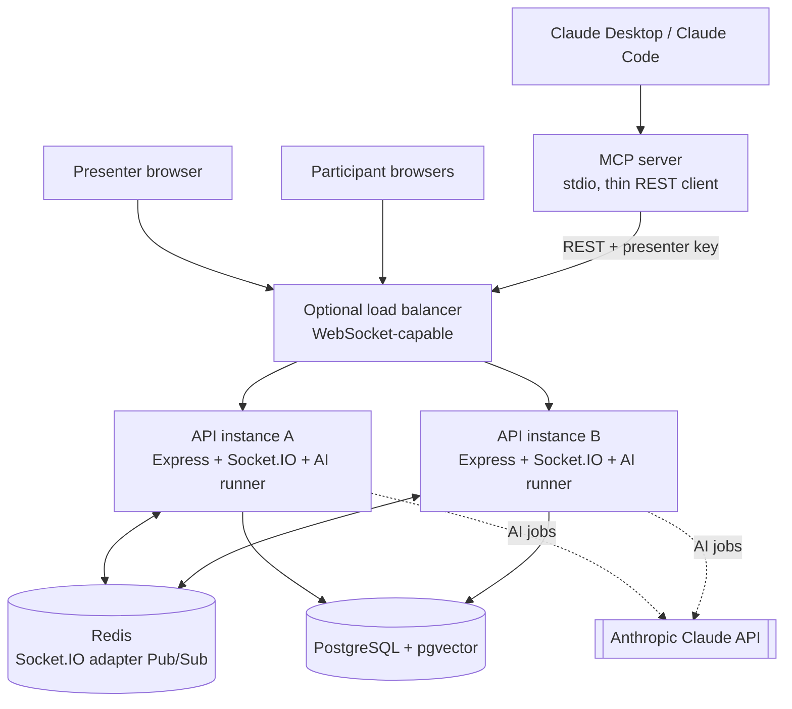
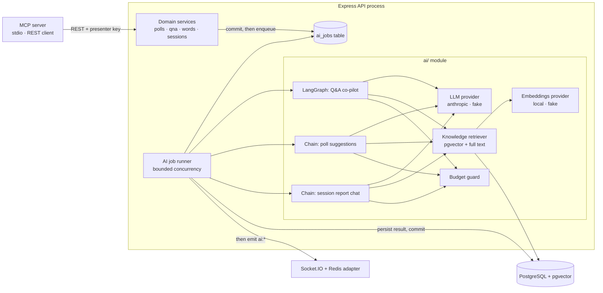

# LivePulse — पूरी जानकारी: उत्पाद, Architecture और Specification गाइड (हिंदी)

Version: prototype · तारीख: 2026-10-27 · पाठक: कंपनी demo, HR, engineering, leadership

यह दस्तावेज़ बताता है कि LivePulse क्या करता है, आज क्या बना है, इसका design कैसा है, configuration कैसे होता है, और कौन-सी
limits लागू होती हैं। यह वर्णन repository में मौजूद code के आधार पर है। जो चीज़ें plan में हैं पर अभी बनी नहीं हैं, उन्हें
साफ़ तौर पर चिह्नित किया गया है।

---

## 1. LivePulse क्या है

LivePulse एक real-time audience engagement web app है। एक **presenter** live session चलाता है (जैसे talk, training या town
hall)। **Audience** किसी भी phone या laptop browser से छोटे room code के साथ जुड़ती है, इसके लिए कोई account या app install
नहीं चाहिए। वे polls का जवाब देते हैं, word cloud के लिए शब्द भेजते हैं, questions पूछते और upvote करते हैं, और हर screen पर
सब कुछ live अपडेट होता है।

इस engagement core के ऊपर LivePulse में **presenter के लिए AI co-pilot** है। AI presenter की अपनी सामग्री (slides, PDF,
notes) पढ़ता है, polls सुझाता है, questions को moderate और merge करता है, citations के साथ answer draft करता है, और session के
बाद की report लिखता है। AI खुद audience तक कुछ भी publish नहीं करता। फ़ैसला हमेशा presenter का होता है।

Design के वादे:

1. **Core AI के बिना भी चलता है।** AI बंद हो, धीमा हो, या model provider down हो, तब भी polls, word cloud और Q&A चलते रहते हैं।
2. **Human in the loop।** AI सिर्फ़ सुझाव और draft देता है। Presenter approve, edit या dismiss करता है।
3. **एक ही source of truth।** सारा data PostgreSQL में रहता है, AI के embeddings भी (pgvector extension के ज़रिए)।
4. **पहले commit, फिर announce।** हर बदलाव पहले database में save होता है, उसके बाद ही live update भेजा जाता है।
5. **सब कुछ offline test हो सकता है।** `fake` AI provider और deterministic embedding provider से पूरा system बिना internet और
   बिना खर्च के चल सकता है।

---

## 2. Users और roles

| Role | कौन | क्या कर सकते हैं |
| --- | --- | --- |
| Presenter (host) | Session चलाने वाला व्यक्ति | Session बनाना, polls और word-cloud prompts चलाना, Q&A संभालना, material upload करना, AI suggestions देखना, session खत्म करना, report पढ़ना, session से सवाल पूछना |
| Participant (audience) | Room code वाला कोई भी व्यक्ति | Display name के साथ join करना, vote करना, हर prompt पर एक शब्द भेजना, अधिकतम पाँच questions पूछना, दूसरों के questions upvote करना |
| AI co-pilot (system actor) | Server पर चलने वाला AI | सिर्फ़ draft और hold। कभी publish नहीं। सिर्फ़ एक session के भीतर काम करता है |
| Evaluator / reviewer | Engineers, CTO, HR | App local पर चलाना, docs पढ़ना, tests चलाना |

Identity का तरीका: कोई user account नहीं है। Session बनते समय presenter को **presenter key** एक बार दिया जाता है। Server पर
यह सिर्फ़ hash के रूप में रहती है। Participant join करते समय **opaque participant token** पाता है। दोनों HttpOnly cookies में
रहते हैं, हर session और role के लिए अलग cookie।

---

## 3. Feature की स्थिति (ईमानदार सारांश)

| # | Feature | स्थिति | कहाँ है |
| --- | --- | --- | --- |
| 1 | Landing, host, join pages | बना है | Web: `/`, `/host`, `/join` |
| 2 | Session बनाना, room code, presenter key | बना है | API sessions का controller और service |
| 3 | Real-time backbone (Socket.IO + Redis adapter, presence, reconnect) | बना है | API `realtime/`, web realtime hooks |
| 4 | Live polls (DRAFT → ACTIVE → CLOSED, हर participant एक vote, live results) | बना है | Polls routes और services |
| 5 | Word cloud (हर participant हर prompt पर एक शब्द, live cloud) | बना है | Word-prompt routes और services |
| 6 | Live Q&A (questions, upvotes, moderation, pin, hide, answered) | बना है | Question routes और services |
| 7 | AI foundation (job queue, runner, budget, kill switch, providers) | बना है | `api/src/ai/` |
| 8 | Knowledge base / RAG (PDF या text upload, chunk, embed, hybrid search) | बना है | `knowledge/`, knowledge routes और page |
| 9 | AI poll generator (material पर आधारित poll सुझाव → poll बनाना) | बना है | Poll-suggestions routes और task |
| 10 | AI Q&A co-pilot (LangGraph: moderate, dedupe, retrieve, draft, self-check, approval) | बना है | `api/src/ai/tasks/qna-copilot/` |
| 11 | Question clusters | बना है | `question_clusters` table, `qna/clusters` route |
| 12 | Session के बाद की report और streaming "Ask your session" chat | बना है | Session-report routes, `ai/session-chat/` |
| 13 | Claude Desktop / Claude Code के लिए MCP server (8 tools) | बना है | `api/src/mcp/` |
| 14 | AI action approval panel (MCP से आए proposals presenter के सामने) | बना है | `ai_actions` table, web में AI panel |
| 15 | AI के लिए operator kill switch | बना है (हर instance पर अलग, §12 देखें) | `PATCH /api/ops/ai` |
| 16 | Emoji reactions, throttled bursts और per-minute counts | **Plan में है, बना नहीं** | Phase 8 |
| 17 | Live audience insights (semantic word themes, sentiment pulse, room summary) | **Plan में है, बना नहीं** | Phase 13 |
| 18 | Pulse Coach (live signals से presenter के लिए सलाह) | **Plan में है, बना नहीं** | Phase 13 |
| 19 | Demo seed data और two-instance demo script | **Plan में है, बना नहीं** | Phase 17 |

Automated tests का विवरण §14 में है।

---

## 4. Feature का विस्तार से विवरण

### 4.1 Session और join

- Presenter title (80 characters तक) और वैकल्पिक description (500 characters तक) देता है।
- Server **room code** बनाता है: 6 characters, 31 characters के alphabet से, जिसमें मिलते-जुलते अक्षर नहीं हैं (जैसे `0`/`O`
  या `1`/`I` नहीं)। Collision होने पर सीमित संख्या में दोबारा कोशिश होती है।
- Presenter key एक बार दिखाई जाती है। Session page पर room code और join link है, हर एक के साथ copy button।
- Participant join link खोलता है या code टाइप करता है, display name (30 characters तक) देता है, और एक token पाता है। Page refresh
  होने पर वही stored token दोबारा इस्तेमाल होता है।
- Room code सिर्फ़ खोजने के लिए है। इससे presenter के अधिकार नहीं मिलते।
- Session की दो स्थितियाँ हैं: ACTIVE और ENDED। Session खत्म होने पर सब कुछ read-only हो जाता है, खुला poll, prompt या Q&A बंद
  होता है, uploaded knowledge documents हटते हैं, और end का समय उसी database transaction में लिखा जाता है।
- Presence (कितने लोग जुड़े हैं) live है और database में count के रूप में stored नहीं होता। यह Socket.IO से आता है, इसलिए कई
  instances पर भी सही रहता है।

### 4.2 Live polls

- Presenter एक सवाल (200 characters तक) और 2 से 6 options (हर एक 80 characters तक) लिखता है। एक जैसे option labels (letter
  case को अनदेखा करके) मना हैं।
- Lifecycle: **DRAFT** (संपादन योग्य, छिपा हुआ) → **ACTIVE** (votes ले रहा) → **CLOSED** (अंतिम, बदला नहीं जा सकता)।
- एक session में एक समय पर सिर्फ़ एक poll ACTIVE हो सकता है। यह नियम database लागू करता है।
- हर participant हर poll पर एक बार vote कर सकता है। भारी concurrency में भी database दूसरा vote रोकता है।
- Votes database में गिने जाते हैं। Vote के लगभग 250 ms बाद room को results भेजे जाते हैं, हर poll के लिए combined।
- Results दिखें या नहीं, यह presenter तय करता है (`show_results`)। छिपे हुए results server पर लागू होते हैं, सिर्फ़ browser में नहीं।
- Poll close और vote एक row lock से क्रमबद्ध होते हैं। इसलिए vote या तो close से पहले गिना जाता है या मना हो जाता है। कुछ भी
  अस्पष्ट नहीं रहता।

### 4.3 Word cloud

- Presenter एक prompt (सवाल 200 characters तक) खोलता है, शुरू करता है, और बाद में बंद करता है।
- हर participant हर prompt पर एक शब्द या छोटा वाक्यांश भेज सकता है (display form 30 characters तक)।
- गिनती के लिए शब्द normalise होते हैं: extra spaces हटते हैं और key के लिए lower case होता है, जबकि display के लिए सबसे
  आम spelling रखी जाती है।
- Cloud में top 30 terms दिखते हैं, count के हिसाब से (ज़्यादा पहले), फिर key से। गिनती database में होती है।
- Exact-count cloud deterministic है और **AI नहीं** है। AI themes अलग से plan में हैं (§3, item 17)।

### 4.4 Live Q&A

- Participants questions भेजते हैं (200 characters तक)। हर participant एक session में अधिकतम **पाँच** questions पूछ सकता है।
- वही participant एक ही सवाल दो बार नहीं भेज सकता (key server पर बनती है)।
- Participants दूसरों के questions एक-एक बार upvote करते हैं। कोई अपने सवाल को upvote नहीं कर सकता।
- List upvotes के हिसाब से (ज़्यादा पहले), फिर सबसे पुराने पहले। Upvote count upvote table से गिना जाता है, कोई अलग number stored
  नहीं होता, ताकि बहुत लोगों के एक साथ vote करने पर contention न हो।
- Presenter कर सकता है:
  - किसी question को answered mark करना (500 characters तक का answer),
  - question छिपाना (छिपे questions room को कभी नहीं दिखते),
  - एक समय पर एक question pin करना (database एक session में एक ही pinned question की अनुमति देता है),
  - room के लिए Q&A चालू या बंद करना।
- Session खत्म होने पर Q&A बंद हो जाता है। Moderation session खत्म होने के बाद भी हो सकता है।

### 4.5 Knowledge base (RAG)

- Presenter एक **PDF** या **plain text** file upload करता है (अधिकतम 10 MB)। एक session में अधिकतम **20 documents**। एक ही file
  content दो बार एक session में नहीं जोड़ा जा सकता।
- File का प्रकार उसके content से जाँचा जाता है, सिर्फ़ नाम से नहीं।
- Text निकालना एक अलग worker thread में होता है: 256 MB memory सीमा, 30 सेकंड का timeout, और 300 pages तथा 20,00,000
  characters की सीमा। Web request file को कभी parse नहीं करता।
- Text लगभग 800 characters के passages में बँटता है, 100 characters overlap के साथ। एक passage दो pages को नहीं जोड़ता। हर
  passage को एक local model 384 numbers के vector (embedding) में बदलता है। Local embeddings provider इस्तेमाल होने पर file का
  content मशीन से बाहर नहीं जाता।
- Passages PostgreSQL में रहते हैं। ये सिर्फ़ presenter को दिखते हैं और session खत्म होने पर हट जाते हैं।
- **Hybrid search**: presenter सामग्री में खोज करता है। System दो तरह की खोज चलाता है: vector (अर्थ) और keyword (सटीक शब्द),
  दोनों सूचियों को मिलाता है, सबसे अच्छे candidates को rerank करता है, और top 8 लौटाता है। कमज़ोर matches (न्यूनतम score से
  कम) हटा दिए जाते हैं, ताकि system बिना आधार के जवाब न गढ़े।
- Retrieved text को data माना जाता है और plain text के रूप में दिखाया जाता है।

### 4.6 AI poll generator

- Presenter poll सुझाव माँगता है। AI session की सामग्री से संबंधित passages पढ़ता है।
- Output एक schema से जाँचा जाता है: हर सुझाव में एक question, 2 से 6 options, एक छोटा rationale और source passage ids होते
  हैं।
- सुझाव AI suggestion के रूप में चिह्नित होते हैं। Presenter एक सुझाव edit करके सामान्य DRAFT poll बना सकता है। Presenter poll
  start न करे तब तक audience तक कुछ नहीं पहुँचता।
- Rate limit: प्रति session प्रति मिनट 6 requests।

### 4.7 AI Q&A co-pilot (LangGraph)

हर नए question पर एक AI job चलती है, जो इन चरणों वाली एक छोटी state machine चलाती है:

1. **moderate**: question को OK, TOXIC, SPAM, OFF_TOPIC या PII में वर्गीकृत करता है, और उसकी भाषा पहचानता है। OK न होने वाला
   question **hold** होता है: सिर्फ़ presenter उसे देखता है।
2. **embed**: question (अंग्रेज़ी में) को vector में बदलता है।
3. **dedupe**: अगर question किसी मौजूदा question से 90% (configurable) मिलता है, तो वह उसी में **merge** हो जाता है, और पूछने
   वाले का upvote मूल question पर चला जाता है। नहीं तो वह निकटतम cluster (75% similarity) में जुड़ता है या नया cluster बनाता
   है।
4. **retrieve**: इसी session की सामग्री से passages ढूँढता है। अगर कोई नहीं मिलता, तो उत्तर "Not covered in the materials"
   होता है, और model को कोई call नहीं जाती।
5. **draft**: छोटा उत्तर लिखता है (500 characters तक, एक पंक्ति, plain text) जिसमें अधिकतम तीन citations होते हैं। या तो grounded
   होता है या "not covered" चिह्नित होता है। Citations न हों तो एक बार दोबारा कोशिश होती है।
6. **selfCheck**: एक अलग AI call हर claim को उद्धृत passages से मिलाती है। Unsupported draft दोबारा लिखा जाता है (अधिकतम दो
   कोशिशें), फिर "not covered" माना जाता है। जो draft self-check में fail हुआ, उसे presenter approve नहीं कर सकता।
7. **awaitPresenter**: draft presenter की review panel में रुकता है। Room को कुछ नहीं दिखता।

Presenter approval: presenter draft edit कर सकता है (500 characters तक) और approve कर सकता है। सिर्फ़ approved text answer के रूप
में save होता है, citations सिर्फ़ document का नाम और location के साथ। Room को सूचना मिलती है और वह HTTP से answer दोबारा लेता है।
Socket पर draft text कभी नहीं जाता।

Fail-open व्यवहार: अगर question आने के समय AI बंद, budget से बाहर या उपलब्ध नहीं है, तो question तुरंत दिखता है और कोई AI job
नहीं चलती। अगर run स्थायी रूप से fail हो जाए, तो question room को जारी कर दिया जाता है, और presenter फिर भी उसे छिपा सकता है।

### 4.8 Session के बाद की report और "Ask your session"

- **Report database से computed होती है**, AI उसे नहीं लिखता। इसमें poll results, word-cloud के top terms, question counts,
  सबसे ज़्यादा upvote वाले questions, knowledge documents की ingest संख्या और AI usage होते हैं। Report JSON में export हो सकती
  है। सभी संख्याएँ SQL से आती हैं, इसलिए model संख्याएँ नहीं बनाता।
- **"Ask your session"** presenter के लिए एक chat है। हर सवाल के साथ session का snapshot बनता है। Model सिर्फ़ चार read-only
  tools चला सकता है (poll results, questions खोजना, word themes, material खोजना)। Tools को server presenter के session से
  बाँधता है, इसलिए model किसी दूसरे session तक नहीं पहुँच सकता। एक turn में अधिकतम 4 tool rounds और 45 सेकंड। जवाब presenter
  के अपने request पर Server-Sent Events से stream होता है। हर जवाब tool results से cite होता है, और source labels server तय
  करता है, model नहीं।
- हर chat turn session budget से tokens (डिफ़ॉल्ट 8,000) reserve करता है और असली usage से settle करता है।
- अगर session के दौरान AI चालू था, तो session खत्म होने के बाद भी chat उपलब्ध रहता है।

### 4.9 MCP server (Claude Desktop और Claude Code)

- एक अलग program (`npm run mcp -w api`) standard input और output पर Model Context Protocol बोलता है।
- यह **REST API का thin client** है। इसका कोई database connection नहीं है और लिखने का कोई दूसरा रास्ता नहीं है, इसलिए वही
  validation, authorisation और commit-then-announce नियम लागू होते हैं।
- Tools:

| Tool | प्रकार | असर |
| --- | --- | --- |
| `get_session_snapshot` | Read | Session की स्थिति, polls, top questions, हाल के AI actions |
| `suggest_polls` | Read | Poll generator चलाकर सुझाव लौटाता है |
| `list_questions` | Read | दिखने वाले questions (अधिकतम 50) |
| `get_session_report` | Read | Session की report |
| `propose_create_poll` | Proposal | Pending CREATE_POLL action सहेजता है |
| `propose_start_poll` | Proposal | Pending START_POLL action सहेजता है |
| `propose_close_poll` | Proposal | Pending CLOSE_POLL action सहेजता है |
| `propose_publish_answer` | Proposal | Pending PUBLISH_ANSWER action सहेजता है |

- Proposals `ai_actions` table में status `PROPOSED` के साथ सहेजे जाते हैं और presenter की AI panel में दिखते हैं। ये तभी चलते हैं
  जब presenter approve करे। Status का क्रम: PROPOSED → APPROVED या REJECTED → EXECUTED या FAILED।
- Configuration Claude Desktop की MCP entry में होता है: API URL, session id और presenter key (एक key एक session के लिए)।

### 4.10 AI controls

- Global kill switch: environment variable `AI_ENABLED` (example file में डिफ़ॉल्ट true)।
- Per-session toggle: presenter एक session के लिए AI चालू या बंद कर सकता है।
- Operator switch: `PATCH /api/ops/ai`, जो कम से कम 32 characters के header key से सुरक्षित है। AI बंद करने पर लंबित jobs रद्द
  होते हैं और नई jobs मना होती हैं। Operator key सेट न हो तो यह route 503 लौटाता है।
- हर session का token budget (डिफ़ॉल्ट 2,00,000 tokens)। Job चलने से पहले अपना अनुमान reserve करता है और बाद में असली usage से
  settle करता है।
- AI usage panel presenter को tokens और job status दिखाता है।

### 4.11 Planned features (अभी बने नहीं हैं)

- **Emoji reactions** (👍 ❤️ 😂 😮 👏 🤔): तय set, rate limit के साथ, लगभग हर 500 ms पर bursts में भेजे जाते हैं, और per-minute
  counts के रूप में save होते हैं, हर tap की अलग row नहीं।
- **Live audience insights**: word-cloud answers पर semantic themes, sentiment pulse, और माँगने पर room summary, जो तय अंतराल
  से ज़्यादा बार refresh नहीं होते।
- **Pulse Coach**: presenter के लिए सलाहकार, जो तय नियमों (जैसे poll का 50/50 के पास बँटना) पर चलता है। LLM सिर्फ़ सुझाव का
  वाक्य लिखता है। सुझाव खुद कोई कदम नहीं उठाते।
- **Demo seed data** और two-instance demo script।

---

## 5. Architecture

### 5.1 मुख्य diagram



### 5.2 Technology stack

| Layer | Technology | Version (package files से) |
| --- | --- | --- |
| Web front end | Next.js App Router, React, Tailwind CSS | Next 15.5, React 19.3, Tailwind 4.3 |
| Front-end realtime | socket.io-client | 4.8 |
| API | Node.js (engines field में 20 या बाद का), Express | Express 5 |
| Database access | Sequelize, PostgreSQL driver के साथ | Sequelize 6.37, pg 8 |
| Database | PostgreSQL 16 with pgvector | `pgvector/pgvector:pg16` image |
| Realtime | Socket.IO with Redis adapter | socket.io 4.8, @socket.io/redis-adapter 8.3, Redis 7 |
| Validation | Zod (API और web दोनों में) | Zod 3.25 (API), 3.23+ (web) |
| Logging | Pino | 9 |
| Security headers | Helmet, CORS | Helmet 8 |
| AI orchestration | LangChain.js core, LangGraph.js | @langchain/core 1.3.0, @langchain/langgraph 1.4.21 |
| LLM | @langchain/anthropic के ज़रिए Anthropic Claude | 1.6.0; डिफ़ॉल्ट model `claude-opus-5-5` |
| Embeddings और reranking | Transformers.js, local ONNX models के साथ | @huggingface/transformers 4.3.1 |
| PDF text | unpdf | 1.8.1 |
| Tool protocol | Model Context Protocol SDK | 1.32.1 |
| Tests | Vitest, Supertest, Testing Library, Playwright (installed) | Vitest 2.1 |
| Local infrastructure | Docker Compose | PostgreSQL + pgvector, Redis 7 |

Monorepo layout (npm workspaces):

```
shared/   Zod schemas, DTO types, socket event maps, constants (embedding size, emoji set)
api/      Express + Socket.IO + Sequelize + ai/ module + mcp/ entry point
web/      Next.js App Router + Tailwind
```

### 5.3 हर layer की ज़िम्मेदारी

| Layer | क्या करती है | क्या कभी नहीं करती |
| --- | --- | --- |
| Next.js web | UI दिखाती है; commands और snapshots के लिए REST; sockets सुनती है | Authorisation या counts तय नहीं करती |
| Express controllers | Zod से input जाँचती है, authenticate करती है, service बुलाती है, errors को standard envelope में बदलती है | Business logic नहीं रखती |
| Services | Business rules, transactions, loaded records पर authorisation, उसी transaction में AI jobs queue करना | Transaction के भीतर event emit नहीं करतीं |
| PostgreSQL | Source of truth, constraints, aggregation, vector search | — |
| Socket.IO | Committed बदलाव को तेज़ी से फैलाना | Storage के रूप में काम नहीं करता |
| Redis adapter | Instances के बीच broadcast | Durable replay नहीं |
| AI module | Data पढ़ता है, LLM या embeddings बुलाता है, suggestions save करता है, presenter को बताता है | Audience को approval के बिना publish नहीं करता; request के भीतर नहीं चलता |
| MCP server | REST API को presenter key से बुलाकर presenter tools देता है | Database को सीधे नहीं छूता, API नियम नहीं तोड़ता |

### 5.4 Code की संरचना

```
api/src/
  config/        environment validation (Zod), logger
  models/        Sequelize models और associations
  services/      business rules और transactions
  controllers/   request handlers
  routes/        route definitions
  validation/    Zod request schemas
  middleware/    origin check, rate limits, cookies, errors
  realtime/      socket server, handshake auth, room join, handlers, emit helpers
  ai/            providers/, embeddings/, runner.ts, tasks/, session-chat/
  knowledge/     upload और extraction worker
  mcp/           MCP server entry और tools (REST API बुलाते हैं)
api/migrations/  generated migrations, हर एक में up और down
web/src/
  app/           pages (App Router)
  components/    UI, polls, qna, word-cloud, ai, knowledge, report, sessions
  hooks/         data और realtime hooks
  lib/           API client, routes, helpers
```

### 5.5 Pages

| Path | कौन | उद्देश्य |
| --- | --- | --- |
| `/` | सभी | Landing page |
| `/host` | Presenter | Session बनाना; room code और join link दिखाना |
| `/join` | Participant | Room code और नाम डालना |
| `/host/[sessionId]` | Presenter | Live control room: polls, word cloud, Q&A, AI panel |
| `/host/[sessionId]/knowledge` | Presenter | Session की सामग्री upload और manage करना |
| `/host/[sessionId]/report` | Presenter | अंतिम report और "Ask your session" |
| `/room/[roomCode]` | Participant | Participant का अनुभव: vote, शब्द, सवाल, upvote |

### 5.6 Write flow (मुख्य नियम)

हर write एक ही पाँच चरणों से गुज़रता है:

1. Zod से request जाँचना (HTTP और socket दोनों)।
2. उस session के लिए cookie या token की पुष्टि करना जो record का मालिक है।
3. Transaction शुरू करना और ज़रूरी rows lock करना (§6 देखें)।
4. Commit करना। अगर write को AI भी चाहिए, तो AI job की row उसी transaction में डाली जाती है।
5. सिर्फ़ commit के बाद सही room को live update भेजना। Redis down हो तो भी database में लिखा बदलाव रहता है, और clients HTTP
   से दोबारा लेकर अंतर भरते हैं।

Votes और word answers HTTP से जाते हैं, socket commands से नहीं। Sockets सिर्फ़ commit हो चुके बदलाव बताते हैं।

### 5.7 Realtime design

- Socket.IO उसी HTTP server पर path `/api/socket.io` पर चलता है, सिर्फ़ WebSocket transport के साथ।
- हर session के लिए दो rooms: `session:<id>` (session में सभी) और `presenter:<id>` (सिर्फ़ presenter: AI drafts, held questions,
  AI usage)।
- Handshake जाँच इस क्रम में होती है: origin check, client address और session के लिए connection सीमा, cookie से
  authentication, और connection स्वीकार होने से पहले room join।
- सीमाएँ: एक client address पर 20 connections और एक instance पर एक session में 500 (configurable)। Presence count disconnect के
  बाद 5 सेकंड तक रुकता है, ताकि page refresh पर count झपके नहीं।
- Events (उदाहरण): `poll:started`, `poll:results`, `poll:closed`, `poll:updated`, `wordcloud:started`, `wordcloud:results`,
  `wordcloud:closed`, `wordcloud:updated`, `question:created`, `question:updated`, `question:upvotes`, `qna:status`,
  `qna:review-updated`, `qna:clusters-updated`, `poll-suggestions:ready`, `knowledge:document-status`, `ai:status`, `ai:usage`,
  `ai:job-failed`, `ai-action:updated`, `session:ended`।
- Events में ids और छोटे fields होते हैं, निजी content नहीं। उदाहरण: `knowledge:document-status` में न text होता है न file का
  नाम; AI events में कभी prompts या outputs नहीं होते।
- Reconnect: client अपना session जाँचता है, फिर HTTP से मौजूदा स्थिति लेता है। Events entity id और version से idempotent हैं।
- Redis outage: sockets जुड़े रहते हैं, `/ready` `degraded` दिखाता है, और स्थानीय clients को `REALTIME_DEGRADED` सूचना मिलती है।
  Redis Pub/Sub durable नहीं है, इसलिए छूटे broadcasts दोबारा नहीं भेजे जाते; HTTP refetch अंतर भरता है।
- Shutdown: स्थानीय sockets को `SERVER_RESTARTING` सूचना, फिर 10 सेकंड के भीतर sockets और Redis बंद।

### 5.8 AI architecture

AI का काम कभी HTTP request या database transaction के भीतर नहीं चलता।



मुख्य AI design बातें:

- **PostgreSQL में job queue** (`ai_jobs`)। यही queue है और इतिहास भी। अलग queue service की ज़रूरत नहीं। सक्रिय jobs पर unique key
  से डुप्लिकेट requests नज़रअंदाज़ होती हैं।
- **Runner**: हर सेकंड जाँचता है, और job queue होते ही उसे जगाया जाता है। Concurrency सीमित है (डिफ़ॉल्ट 2)। अटकी हुई running jobs
  startup पर और हर 60 सेकंड पर वापस ली जाती हैं। Retries में बढ़ता हुआ, सीमित इंतज़ार होता है।
- **Job claim**: पहले session की row lock होती है, फिर job claim होती है। सिर्फ़ एक runner जीतता है।
- **Completion शर्त के साथ**: पुराना run नए run का परिणाम overwrite नहीं कर सकता।
- **Provider चयन**: `fake` (example file और सभी tests में डिफ़ॉल्ट) या `anthropic`। `anthropic` के लिए API key चाहिए, वरना startup
  पर fail होता है। Provider की errors तय, सुरक्षित codes में बदली जाती हैं।
- **Structured output**: हर model जवाब एक Zod schema से जाँचा जाता है। गलत output एक बार दोबारा, फिर job fail होता है और सुरक्षित
  संदेश दिखता है। बिना जाँचा output कभी नहीं दिखाया जाता।
- **Untrusted text**: audience का text data के रूप में लपेटा जाता है, निर्देश के रूप में कभी नहीं। Audience से शुरू होने वाले flows
  में model के पास state बदलने वाले tools नहीं हैं।
- **लेबलिंग**: AI से बनी हर चीज़ पर "AI suggestion" या "AI draft" लिखा होता है। Word cloud deterministic है और उसे AI नहीं कहा जाता।
- **Models**: डिफ़ॉल्ट model `claude-opus-5-5` है, जो `AI_MODEL` से तय होता है। Embedding model local है और 384-dimensional है।
- **ज्ञात integration नियम**: मौजूदा Claude models temperature जैसे sampling parameters और forced tool choice को reject करते हैं।
  Code structured output और automatic tool choice इस्तेमाल करता है।

### 5.9 Vector search

- Vectors PostgreSQL में pgvector extension के साथ रहते हैं, cosine distance पर HNSW index के साथ।
- Vectors सिर्फ़ bound parameters से लिखे और पढ़े जाते हैं। Text या vectors कभी SQL string में नहीं जोड़े जाते।
- हर query पहले session id से filter होती है।
- Embedding का आकार बदलने पर migration और re-embedding चाहिए। यह आकार API और migrations में साझा constant है।

---

## 6. Data model और consistency नियम

### 6.1 Tables

| Table | उद्देश्य | मुख्य नियम |
| --- | --- | --- |
| `sessions` | Session, room code, presenter key का hash, स्थिति, Q&A switch, AI switch और usage | Room code unique; presenter key hash unique; end time सिर्फ़ ENDED होने पर |
| `participants` | Session के audience members | Token hash unique; session के साथ हटते हैं |
| `polls` | Poll के सवाल और lifecycle | एक session में एक ACTIVE (partial unique index); closed time status से मेल खाता है |
| `poll_options` | हर poll के 2 से 6 options | Position 0 से 5; poll में labels unique |
| `votes` | हर participant का हर poll पर एक row | (poll, participant) unique; option उसी poll का होना चाहिए (composite foreign key) |
| `word_prompts` | Word-cloud prompts | एक session में एक ACTIVE |
| `word_responses` | हर participant का हर prompt पर एक answer | (prompt, participant) unique |
| `questions` | Q&A questions, AI status, answers | एक session में एक pinned; हर participant का एक question text unique |
| `question_upvotes` | हर participant का हर question पर एक upvote | (question, participant) unique; गिना जाता है, stored नहीं |
| `question_clusters` | मिलते-जुलते questions के समूह, running centroid के साथ | Q&A co-pilot बनाता है |
| `ai_jobs` | AI job queue और इतिहास | Status, attempts, token usage, model और prompt version दर्ज |
| `ai_answer_drafts` | Presenter review के लिए drafts | हर question पर एक; citations stored |
| `knowledge_documents` | Upload की गई सामग्री की metadata और status | Status PROCESSING, READY या FAILED; session में डुप्लिकेट content मना |
| `knowledge_passages` | Text के टुकड़े, 384-number embeddings के साथ | सिर्फ़ presenter को दिखते हैं; session के साथ हटते हैं |
| `ai_poll_suggestions` | AI poll सुझाव | Status SUGGESTED, ACCEPTED या DISMISSED |
| `session_chat_turns` | Ask-your-session chat का इतिहास | Answer सीमा 8,000 characters; session के साथ हटता है |
| `ai_actions` | MCP से आए proposals और उनकी status | PROPOSED → APPROVED/REJECTED → EXECUTED/FAILED |

नियम: UUID primary keys, snake_case column names, `created_at` और `updated_at` timestamps (votes और upvotes को `updated_at` नहीं
चाहिए क्योंकि वे अंतिम होते हैं)। हर schema बदलाव एक generated migration है, जिसमें `up` और `down` दोनों हैं।

### 6.2 Locks और concurrency

- **Lock का क्रम हमेशा पहले session, फिर child row** (poll, prompt, question, job)। इससे deadlock नहीं होता।
- **Voting**: poll पर shared lock। Close exclusive lock लेता है, इसलिए चल रहे votes का इंतज़ार करता है। Vote या तो close से पहले
  commit होकर गिना जाता है, या poll बंद दिखने पर मना होता है।
- **Q&A cap**: submission के समय participant की row lock होती है, इसलिए concurrency में भी पाँच questions की सीमा बनी रहती है।
- **Unique constraints आख़िरी गारंटी हैं।** डुप्लिकेट vote या word पर साफ़ conflict error आता है, जो transaction के बाहर map होता है।
- **कभी नहीं**: LLM call, embedding batch या socket acknowledgement के दौरान transaction खुला नहीं रखा जाता।
- Tested concurrency नियम: एक participant के दो एक साथ votes से exactly एक vote store होता है, और vote के साथ poll close होने पर
  vote या तो गिना जाता है या मना होता है।

### 6.3 Data retention

Prototype नीति: data तब तक रहता है जब तक दस्तावेज़ित manual cleanup session को नहीं हटाता। Session हटने पर उसकी हर child row हटती
है, passages और AI outputs सहित। कोई अपने-आप data हटाने वाला job नहीं चलता।

---

## 7. API overview

Base path `/api`। सफल response: `{ "success": true, "data": ... }`। Error: `{ "success": false, "error": { "code", "message", "details"? } }`।
Responses में stack trace, SQL, secrets, hashes या embeddings कभी नहीं होते।

मुख्य समूह:

- **Sessions**: बनाना (presenter), id से लेना, room code से लेना (public, सिर्फ़ participant-safe fields), session खत्म करना
  (presenter), session की स्थिति का snapshot, settings जैसे Q&A और AI चालू/बंद।
- **Polls**: सूची, participants के लिए current poll, start, close, results दिखाने का switch, vote।
- **Word prompts**: सूची, participants के लिए current prompt, start, close, cloud दिखाने का switch, शब्द भेजना।
- **Questions**: भेजना, सूची (participant-safe), upvote, moderation (hide, answer, pin), Q&A review queue, clusters।
- **Knowledge**: upload (raw bytes, file का नाम header में), documents की सूची, document हटाना, खोज।
- **AI**: session की AI स्थिति, job id से job, poll suggestions (अनुरोध और नवीनतम परिणाम), AI actions (सूची, approve, reject)।
- **Report**: report JSON, export, chat turn (streamed)।
- **Operator**: `PATCH /api/ops/ai` (operator key header के साथ)।
- **Health**: `/health` (जीवित है या नहीं) और `/ready` (PostgreSQL, Redis और AI स्थिति, बिना secrets)।

Authentication:

- Presenter और participant की पहचान HttpOnly cookies से होती है, `SameSite=Lax`, path `/api`, सात दिन की उम्र, और production में
  `Secure` flag। Cookies में random tokens होते हैं; server सिर्फ़ उनके SHA-256 hashes stored करता है।
- POST requests के साथ `Origin` header होना चाहिए जो तय web origin से मेल खाए।
- Room code कभी अधिकार नहीं देता।

---

## 8. सुरक्षा और privacy

- **Input validation**: हर HTTP body और हर socket event का Zod से इस्तेमाल से पहले जाँच, size limits के साथ।
- **Server पर authorisation**: हर write session की cookie या token को उस record के session से मिलाता है। Cross-session access मना है।
- **Secrets**: presenter key, participant tokens और Anthropic key कभी log नहीं होते और browser को नहीं भेजे जाते। Database में
  सिर्फ़ hashes रहते हैं।
- **Headers और origins**: Helmet security headers, explicit CORS origin, writes पर origin check।
- **Rate limits**: joins, writes और AI routes पर लागू (जैसे प्रति session प्रति मिनट 6 AI poll suggestions)।
- **Prompt injection**: audience text को untrusted data के रूप में लेबल किया जाता है। Model output schema से जाँचा जाता है और plain
  text के रूप में दिखाया जाता है। Presenter के बिना कुछ publish नहीं होता।
- **Data minimisation**: डिफ़ॉल्ट रूप से display names model को नहीं भेजे जाते।
- **Disclosure**: जब Anthropic provider इस्तेमाल होता है, तब presenter को बताया जाता है कि audience text बाहरी AI provider को भेजा
  जाता है।
- **Local-first embeddings**: local embeddings provider के साथ अपलोड की गई सामग्री मशीन पर ही embed होती है।
- **ईमानदार सीमाएँ**: production security audit नहीं हुआ है। Account system नहीं है, इसलिए presenter key ही एकमात्र presenter
  credential है। Participants anonymous हैं।

---

## 9. Configuration reference

सारी configuration एक फ़ाइल `.env` में रहती है, जो `.env.example` से बनती है। नीचे दिए नाम और डिफ़ॉल्ट code के हैं। असली secret
values कभी commit नहीं होनी चाहिए। Environment startup पर जाँचा जाता है। कोई value गायब या गलत हो, तो server रुककर समस्या का
नाम बताता है (secret values कभी नहीं छापता)।

### 9.1 Core settings

| Variable | डिफ़ॉल्ट | ज़रूरी | अर्थ |
| --- | --- | --- | --- |
| `NODE_ENV` | `development` | नहीं | `development`, `test` या `production` |
| `PORT` | `4000` | नहीं | API port (1 से 65535) |
| `WEB_ORIGIN` | — | हाँ | अनुमति प्राप्त web origin(s), comma से अलग, HTTP या HTTPS |
| `DATABASE_URL` | — | हाँ | PostgreSQL connection string |
| `TEST_DATABASE_URL` | — | सिर्फ़ integration tests | ऐसे database की ओर इशारा करे जिसका नाम `_test` पर खत्म हो |
| `REDIS_URL` | — | हाँ | Redis connection string (`redis://` या `rediss://`) |
| `TRUST_PROXY` | `false` | नहीं | सिर्फ़ reverse proxy के पीछे `true`, ताकि client address सही हो |
| `LOG_LEVEL` | `info` | नहीं | `trace` से `fatal` तक |
| `PRESENCE_GRACE_MS` | `5000` | नहीं | Disconnect के बाद presence count घटने से पहले का इंतज़ार (0 से 60,000) |
| `SOCKET_MAX_PER_IP` | `20` | नहीं | हर client address पर खुली live connections |
| `SOCKET_MAX_PER_SESSION` | `500` | नहीं | एक instance पर हर session की खुली connections |

Docker Compose variables (`POSTGRES_USER`, `POSTGRES_PASSWORD`, `POSTGRES_DB`) स्थानीय database container बनाते हैं। Example values
placeholders हैं; हर team अपनी values चुने।

### 9.2 AI settings

| Variable | डिफ़ॉल्ट | अर्थ |
| --- | --- | --- |
| `AI_ENABLED` | `true` | Process के लिए global AI switch |
| `AI_PROVIDER` | `fake` | `fake` (offline, मुफ़्त) या `anthropic` (असली Claude) |
| `ANTHROPIC_API_KEY` | — | सिर्फ़ `AI_PROVIDER=anthropic` पर ज़रूरी; कभी log नहीं |
| `AI_MODEL` | `claude-opus-5-5` | Drafting, suggestions और report chat के लिए model id |
| `EMBEDDINGS_PROVIDER` | `fake` | `local` (Transformers.js model) या `fake` (deterministic, offline) |
| `EMBEDDINGS_MODEL` | `Xenova/all-MiniLM-L6-v2` | Local embedding model; एक बार download होकर cache होता है (लगभग 23 MB) |
| `EMBEDDINGS_DIM` | `384` | Shared embedding आकार के बराबर होना चाहिए |
| `RERANKER_PROVIDER` | `fake` | `local` (cross-encoder model) या `fake` |
| `RERANKER_MODEL` | `Xenova/ms-marco-MiniLM-L-6-v2` | `RERANKER_PROVIDER=local` पर इस्तेमाल होने वाला local reranker model |
| `AI_MAX_CONCURRENCY` | `2` | एक साथ चलने वाली jobs (1 से 16) |
| `AI_MAX_ATTEMPTS` | `3` | हर job की कोशिशें (1 से 10) |
| `AI_SESSION_TOKEN_BUDGET` | `200000` | हर session के लिए tokens की सीमा, जिसके बाद AI jobs छोड़ी जाती हैं |
| `QNA_DUPLICATE_SIMILARITY` | `0.90` | इस similarity पर नया question मौजूदा में merge होता है (0.5 से 1) |
| `QNA_CLUSTER_SIMILARITY` | `0.75` | इस similarity पर questions एक cluster में आते हैं (0.5 से 1) |
| `OPERATOR_KEY` | — | Optional, कम से कम 32 characters; न हो तो operator route 503 देता है |

### 9.3 MCP settings (Claude Desktop या Claude Code की configuration में, `.env` में नहीं)

| Variable | अर्थ |
| --- | --- |
| `LIVEPULSE_API_URL` | API का base URL, जैसे स्थानीय API address |
| `LIVEPULSE_SESSION_ID` | वह session जिस पर tools काम करते हैं |
| `LIVEPULSE_PRESENTER_KEY` | उस session की presenter key (एक key एक session के लिए) |

### 9.4 Web settings

| Variable | अर्थ |
| --- | --- |
| `NEXT_PUBLIC_API_URL` | Browser को दिखने वाला API base URL। `NEXT_PUBLIC_` से शुरू होने वाली हर चीज़ सार्वजनिक है, इसलिए इसमें कभी secret न रखें |

---

## 10. Specification और सीमाएँ

| क्षेत्र | नियम |
| --- | --- |
| Session title | 1 से 80 characters, trimmed |
| Session description | 500 characters तक, वैकल्पिक |
| Room code | 6 characters, 31 characters का alphabet, मिलते-जुलते अक्षर नहीं |
| Display name | 30 characters तक |
| Poll question | 200 characters तक |
| Poll options | 2 से 6 options, हर एक 80 characters तक, डुप्लिकेट labels नहीं (letter case नज़रअंदाज़) |
| Votes | हर participant हर poll पर एक; सिर्फ़ ACTIVE poll और ACTIVE session में |
| Active polls | एक session में एक खुला poll |
| Word prompt | सवाल 200 characters तक; एक session में एक ACTIVE prompt |
| Word answer | Display form 30 characters तक; हर participant का हर prompt पर एक |
| Word cloud | Top 30 terms |
| Question text | 200 characters तक |
| Questions प्रति participant | एक session में 5 |
| Upvotes | हर participant का हर question पर एक; अपने question पर नहीं |
| Answer text | 500 characters तक |
| Pinned questions | एक session में एक |
| Knowledge file | PDF या plain text; 10 MB तक |
| Knowledge documents | एक session में 20 तक; डुप्लिकेट content मना |
| Extraction सीमाएँ | हर document में 300 pages और 20,00,000 characters; 30 सेकंड timeout; 256 MB worker memory |
| Passage आकार | लगभग 800 characters, 100 overlap; हर document में 2,000 passages तक |
| Search results | Fusion और reranking के बाद top 8 passages |
| AI poll suggestions | प्रति session प्रति मिनट 6 requests; हर request में 1 से 3 सुझाव |
| AI draft | 500 characters तक, एक पंक्ति, plain text, अधिकतम 3 citations |
| Draft कोशिशें | हर question पर अधिकतम 2 drafts |
| Report chat | सवाल 500 characters तक; जवाब 8,000 characters तक; 4 tool rounds; हर turn पर 45 सेकंड |
| Token budget | डिफ़ॉल्ट 2,00,000 tokens प्रति session |
| Session data | मैन्युअल cleanup तक रहता है; session हटाने पर उसका सारा data हटता है |
| Browser support | WebSocket सपोर्ट वाले आधुनिक desktop और mobile browsers |

---

## 11. Deployment और demo चलाना

### 11.1 ज़रूरतें

Node.js LTS (`unpdf` को Node 22.18 या बाद का चाहिए; root `engines` field अभी भी 20 या बाद का कहता है, जो एक खुला मुद्दा है),
Docker Desktop (Compose के साथ), Git। वैकल्पिक: असली AI के लिए Anthropic API key; MCP demo के लिए Claude Desktop।

### 11.2 System शुरू करना

1. `cp .env.example .env` चलाएँ और स्थानीय values भरें।
2. `docker compose up -d` (pgvector वाला PostgreSQL और Redis शुरू करता है)।
3. Repository की root पर `npm install`।
4. `npm run db:migrate -w api` (हर database के लिए एक बार)।
5. एक terminal में `npm run dev:api` और दूसरे में `npm run dev:web`।
6. `http://localhost:3000` खोलें। `http://localhost:4000/health` और `http://localhost:4000/ready` जाँचें।

### 11.3 Offline demo mode

`AI_PROVIDER=fake`, `EMBEDDINGS_PROVIDER=fake` और `RERANKER_PROVIDER=fake` रखें। सब कुछ बिना internet और बिना खर्च के चलता है। असली
models के साथ live demo से पहले एक बार local embeddings चला लें, ताकि model cache में हो।

### 11.4 Two-instance demo (horizontal scaling)

दूसरे port पर एक और API instance चलाएँ, उसी `REDIS_URL` के साथ। Instance B से जुड़ा participant, instance A से शुरू हुआ poll
पाता है। ध्यान दें: इस version में AI on/off switch हर instance पर अलग है (§12 देखें)।

---

## 12. सीमाएँ और खुले मुद्दे (demo में ईमानदारी से बताएँ)

- **एक instance पर AI switch**: runtime AI switch एक process में रहता है। दो instances होने पर एक पर बदलाव दूसरे तक नहीं पहुँचता,
  जब तक switch shared storage में न ले जाया जाए।
- **अभी नहीं बना**: emoji reactions, live audience insights, Pulse Coach, demo seed data।
- **Production security audit नहीं हुआ** और **load-test की क्षमता के दावे नहीं किए गए हैं**।
- **Delivery semantics**: Redis Pub/Sub durable नहीं है और delivery exactly-once नहीं है। Clients HTTP refetch से वापस आते हैं।
- **सिर्फ़ WebSocket**: जो networks WebSocket रोकते हैं, वहाँ live features नहीं चलेंगे।
- **कोई account नहीं**: presenter key ही presenter की credential है; participants anonymous हैं।
- **AI गलत हो सकता है**: इसीलिए हर AI output को presenter की approval चाहिए।
- **असली model पर quality के आँकड़े** (groundedness, duplicate precision, moderation accuracy) रिपोर्ट नहीं किए गए, क्योंकि असली
  model पर इन्हें मापा नहीं गया है। Local reranker की न्यूनतम score (0.5) भी live test तक unverified है।
- **Node version**: `unpdf` को Node 22.18 चाहिए, पर root `engines` field अभी 20 कहता है।
- **Integration tests** को चालू PostgreSQL और Redis चाहिए। §14 के आँकड़ों में ये तब तक शामिल नहीं हैं जब तक इन्हें चलाया न गया हो।

---

## 13. Roadmap

हर planned phase `requirements/` के अंदर एक requirement folder है। Planned, बना नहीं:

| Phase | नाम | क्या देगा |
| --- | --- | --- |
| 8 | live-reactions | Emoji reactions, throttled bursts, per-minute counts |
| 13 | ai-live-insights | Semantic word themes, sentiment pulse, room summary, Pulse Coach |
| 16 | hardening | QA और security review, fixes |
| 17 | demo-readiness | Seed data, README, two-instance script, rehearsal checklist |

---

## 14. Quality और testing

इस दस्तावेज़ के लिए चलाए गए commands और परिणाम (2026-10-27):

| Check | Command | परिणाम |
| --- | --- | --- |
| API unit tests | `npm run test -w api` | 26 files में 172 tests pass |
| API typecheck | `npm run typecheck -w api` | बिना error के pass |
| Shared schema tests | `npm run test -w shared` | 143 tests pass |
| Web unit tests | `npm run test -w web` | 39 files में 261 tests pass |
| Web typecheck | `npm run typecheck -w web` | बिना error के pass |
| Web production build | `npm run build -w web` | Pass; 8 routes build हुए |

Test के प्रकार:

- **Unit tests**: business rules, parsing, validation, AI graph nodes, provider व्यवहार, UI components।
- **Integration tests** (असली PostgreSQL पर Supertest, और Redis के साथ Socket.IO): सिर्फ़ एक अलग test database पर चलते हैं, जिसका नाम
  `_test` पर खत्म हो। ये HTTP flows, locking नियम और concurrency cases कवर करते हैं। इन्हें Docker services चाहिए और ये
  `npm run test:integration -w api` से चलते हैं।
- **Offline AI tests**: हर AI test fake provider इस्तेमाल करता है। कोई test network नहीं छूता।

सिद्धांत: tests business व्यवहार बताते हैं, 400, 401, 403, 404 और 409 cases कवर करते हैं, और कोई failing test हरा करने के लिए
skip या कमज़ोर नहीं किया जाता।

---

## 15. HR और leadership के संभावित सवाल

**एक वाक्य में product क्या करता है?** Presenter live polls, word clouds और questions audience के phones पर चलाता है, और presenter
को AI मदद मिलती है जिसे presenter हमेशा approve करता है।

**क्या AI खुद audience को कुछ भेजता है?** नहीं। AI सुझाव और drafts बनाता है। Presenter हर एक को approve या edit करता है।
Moderation सिर्फ़ किसी question को review के लिए रोक सकता है।

**कंपनी का data कहाँ रहता है?** उस environment के PostgreSQL में जहाँ आप इसे चलाते हैं। Upload की गई सामग्री session हटने तक वहीं
रहती है। Local embeddings provider के साथ embeddings उसी मशीन पर बनते हैं।

**क्या मशीन से बाहर जाता है?** `AI_PROVIDER=anthropic` होने पर, request के लिए ज़रूरी text (जैसे question या draft के लिए
इस्तेमाल passages) Anthropic API को जाता है। Presenter को यह बताया जाता है। `fake` provider के साथ कुछ बाहर नहीं जाता।

**अगर AI provider down हो?** Polls, word cloud और Q&A चलते रहते हैं। AI features बताते हैं कि AI उपलब्ध नहीं है, और दोबारा
कोशिश की जा सकती है।

**AI पर कितना खर्च हो सकता है?** हर session का token budget है (डिफ़ॉल्ट 2,00,000 tokens)। Budget खत्म होने पर jobs छोड़ी जाती हैं।
एक global switch AI पूरी तरह बंद कर देता है।

**जिन लोगों के पास account नहीं, क्या वे भाग ले सकते हैं?** हाँ। Participants room code और display name से join करते हैं।

**क्या system scale होता है?** यह WebSocket सपोर्ट वाले load balancer के पीछे कई API instances पर चल सकता है, और Redis से updates
साझा करता है। Load-test के आँकड़े मापे नहीं गए हैं, इसलिए कोई क्षमता का दावा नहीं किया गया।

**कौन क्या देख सकता है?** Participants polls, allowed होने पर word-cloud results, approved answers और अपना data देखते हैं। AI
drafts, held questions, uploaded सामग्री और report सिर्फ़ presenter देखता है।

---

## 16. शब्दावली

- **RAG (retrieval-augmented generation)**: AI presenter की सामग्री से निकाले गए passages का इस्तेमाल करके जवाब देता है।
- **Embedding**: एक text के अर्थ को दर्शाने वाली numbers की सूची; मिलते-जुलते texts के numbers भी पास होते हैं।
- **pgvector**: PostgreSQL का extension जो embeddings को stored और search करता है।
- **Hybrid search**: अर्थ की खोज और keyword की खोज को मिलाना।
- **Reranker**: एक model जो सबसे अच्छे search candidates को फिर से score करता है, ताकि अंतिम चुनाव बेहतर हो।
- **LangGraph**: कई चरणों वाले AI flow को साफ़ state machine के रूप में चलाने की library।
- **MCP (Model Context Protocol)**: एक standard जिससे Claude जैसे AI assistants बाहरी tools इस्तेमाल कर सकते हैं।
- **Socket.IO**: browser और server के बीच दो-तरफ़ा live connection की library।
- **Redis adapter**: कई API instances को एक-दूसरे के connected clients तक live updates पहुँचाने देता है।
- **Transaction**: database बदलावों का समूह, जो या तो पूरा save होता है या बिल्कुल नहीं।
- **Pinned question**: Q&A का वह सवाल जिसे presenter ने highlight किया है; एक समय पर एक।
- **Kill switch**: एक setting जो किसी feature को तुरंत बंद कर देती है।
