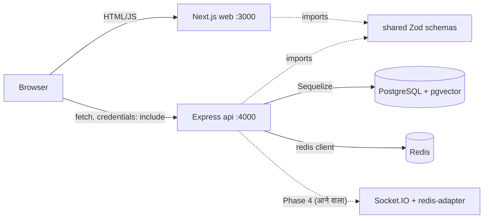
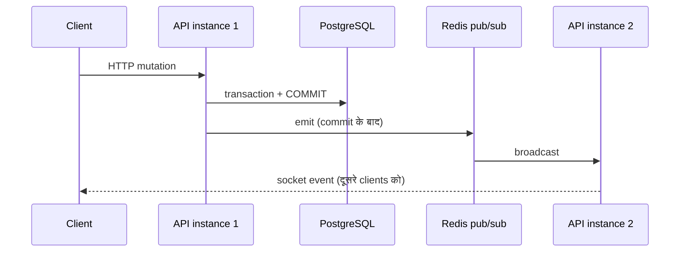

# 02 — आर्किटेक्चर (Architecture)

> स्रोत: `CLAUDE.md`, `api/src/app.ts`, `api/src/server.ts`, `api/src/routes/sessions.routes.ts`,
> `api/src/controllers/sessions.controller.ts`, `api/src/services/sessions.service.ts`,
> `web/src/app/host/page.tsx`, `web/src/lib/api/sessions.ts`, `docker-compose.yml`,
> `requirements/*/planning-tracking.md`।

## 1. तीन हिस्से (Monorepo)

यह एक **monorepo** है — एक ही repository में कई packages, जिन्हें npm **workspaces** जोड़ते हैं।

| Workspace | Tech | ज़िम्मेदारी |
|---|---|---|
| `web/` | Next.js 15 (App Router) + React + TypeScript + Tailwind v4 | Browser में दिखने वाले pages: `/`, `/host`, `/join`, `/host/[sessionId]`, `/room/[roomCode]` |
| `api/` | Express 5 + TypeScript + Sequelize + PostgreSQL (+ Redis) | HTTP API, business rules, database, security |
| `shared/` | Zod schemas | API और web दोनों के लिए एक ही "contract" — request/response की shape (जैसे `createSessionBodySchema`, `ROOM_CODE_ALPHABET`) |

`shared` को TypeScript source की तरह ही इस्तेमाल किया जाता है, कोई build step नहीं
(`requirements/foundation/planning-tracking.md` decision 5)। Web में `next.config.ts` में `transpilePackages`
जोड़ा गया है ताकि Next इसे compile कर सके।

```
LivePulse/
├── web/      Next.js  (port 3000)
├── api/      Express  (port 4000)
├── shared/   Zod contracts  ← web और api दोनों import करते हैं
└── docker-compose.yml  → postgres (5432), redis (6379)
```

## 2. Docker Compose (`docker-compose.yml`)

| Service | Image | Port | ख़ास बात |
|---|---|---|---|
| `postgres` | `pgvector/pgvector:pg16` | 5432 | Data `pgdata` volume में रहता है (restart पर नहीं मिटता); healthcheck `pg_isready` |
| `redis` | `redis:7` | 6379 | Healthcheck `redis-cli ping` |

`pgvector` image अभी से है, पर `vector` extension Phase 9 में बनेगा
(`requirements/foundation/planning-tracking.md` decision 4)।

## 3. बड़ी तस्वीर (Diagram)



ध्यान दें: browser सीधे API (port 4000) को `fetch` करता है। Next.js server API call को proxy नहीं करता
(`web/src/lib/api/sessions.ts` में `fetch(\`${apiBaseUrl}${path}\`)`; `apiBaseUrl` `NEXT_PUBLIC_API_URL` से आता है,
default `http://localhost:4000` — `web/src/lib/config.ts`)।

## 4. API शुरू कैसे होता है (`api/src/server.ts`)

1. Repo-root `.env` मौजूद हो तो `process.loadEnvFile` से पढ़ा जाता है (पहले से set असली env variables जीतते हैं)।
2. `loadEnv(process.env)` — Zod से env जाँच। गलत हो तो fatal log (सिर्फ key का नाम, value नहीं) और `process.exit(1)`।
3. Logger बनता है; `unhandledRejection` / `uncaughtException` पर fatal log + exit।
4. Sequelize बनता है — **PostgreSQL startup पर check नहीं होता**, उसकी स्थिति `/ready` बताता है।
5. Redis से connect — **fail-fast**: न जुड़े तो `Redis is unreachable at startup` log और exit(1)।
6. `initModels(sequelize)` → `createApp({ env, logger, readiness, sequelize, models })` → `app.listen(PORT)`।
7. SIGINT/SIGTERM पर graceful shutdown (10 s timeout) — **(पुष्टि नहीं हुई)**, देखें `11-known-issues.md`।

## 5. Middleware का क्रम (`api/src/app.ts`)

```
requestId → requestLogger → helmet() → cors({origin: WEB_ORIGIN, credentials: true})
→ express.json({limit: '100kb'}) → healthRouter (/health, /ready)
→ '/api' sessionsRouter [originCheck → (rate limiter) → validate → controller]
→ notFound (404) → errorHandler
```

## 6. Step-by-step उदाहरण: "Create session" बटन दबाने पर

```
Browser                Next.js (/host)            Express api                         PostgreSQL
  |  click Create  ──►  CreatePage.handleSubmit
  |                     createSession(values)
  |                     lib/api/sessions.ts
  |  ◄── fetch POST http://localhost:4000/api/sessions (JSON, credentials:'include')
  |  ─────────────────────────────────────────────►  requestId, logger, helmet, cors, json
  |                                                    originCheck → createLimiter → validateBody
  |                                                    controller.create → createSession()
  |                                                    Session.create(...)  ───────────────► INSERT sessions
  |                                                                          ◄─────────────── row (या unique violation → retry)
  |  ◄── 201 {success:true,data:{sessionId,roomCode,joinUrl,presenterKey}} + Set-Cookie lp_presenter_<id>
  |                     SessionCreatedPanel दिखाता है (key सिर्फ memory में, एक बार)
```

विस्तार से:

1. **Browser → Next.js page.** `/host` page (`web/src/app/host/page.tsx`) एक Client Component है
   (`'use client'`), क्योंकि इसमें form state है। Submit पर `handleSubmit` चलता है।
2. **`lib/api` client.** `createSession(values)` (`web/src/lib/api/sessions.ts`) एक साझा `request()` function बुलाता है।
3. **`fetch`.** `POST {apiBaseUrl}/api/sessions`, `Content-Type: application/json`, `credentials: 'include'`
   (ताकि cookie भेजी और ली जा सके)। Origin अलग है (3000 → 4000), इसलिए browser पहले CORS preflight भी भेज सकता है;
   `cors` middleware इसे संभालता है।
4. **`requestId`.** आने वाला `X-Request-Id` सिर्फ तब माना जाता है जब `^[\w-]{1,64}$` से मेल खाए, वरना
   `crypto.randomUUID()`। यह response header, error body और logs में जाता है।
5. **`requestLogger`.** Method, path, status, duration, request ID — body कभी log नहीं होता।
6. **`helmet` + `cors`.** Security headers; सिर्फ `WEB_ORIGIN` list वाले origins को credentials के साथ अनुमति, कभी `*` नहीं।
7. **`express.json`.** 100 kb से बड़ा body → 413 `PAYLOAD_TOO_LARGE`; ख़राब JSON → 400 `VALIDATION_ERROR`।
8. **Origin check** (`api/src/middleware/origin-check.ts`). POST/PUT/PATCH/DELETE पर अगर `Origin` header है और
   allowlist में नहीं → 403 `FORBIDDEN_ORIGIN`। Origin header न हो (curl) तो जाने देता है।
9. **Rate limit** (`api/src/middleware/rate-limit.ts`). Create: 10 प्रति IP प्रति घंटा। ज़्यादा → 429 `RATE_LIMITED` + `Retry-After`।
10. **Validate.** `validateBody(createSessionBodySchema)` — `shared` का Zod schema (title 1–80, description ≤500)। गलत → 400 field details के साथ।
11. **Controller** (`controller.create`). सिर्फ HTTP का काम: body लेना, service बुलाना, cookie set करना, JSON भेजना।
12. **Service** (`createSession` in `sessions.service.ts`). 32-byte random presenter key बनाता है, उसका SHA-256 hash
    निकालता है, और room code बनाकर insert करता है। Room code टकराए (unique violation) तो 5 बार तक retry, फिर
    500 `ROOM_CODE_UNAVAILABLE`।
13. **Sequelize model → PostgreSQL.** `Session.create(...)` → `INSERT INTO sessions`। DB में सिर्फ `presenter_key_hash` जाता है, असली key नहीं।
14. **Response envelope.** `201 { success: true, data: { sessionId, roomCode, joinUrl, presenterKey } }`।
15. **Cookie set.** `Set-Cookie: lp_presenter_<sessionId>=<key>; HttpOnly; SameSite=Lax; Path=/api; Max-Age=7 दिन`
    (`Secure` सिर्फ production में)।
16. **वापस browser.** `request()` response को `successEnvelope(schema)` से Zod-parse करता है और
    `{ ok: true, data }` या `{ ok: false, status, code, message, fields }` लौटाता है। Page key को सिर्फ memory
    (React state) में रखकर एक बार दिखाता है — URL या storage में नहीं।

अगर बीच में कोई error आए, तो वह `errorHandler` (`api/src/middleware/error-handler.ts`) तक पहुँचता है
(Express 5 rejected promises को खुद आगे भेजता है) और यह shape लौटती है:

```json
{ "success": false, "error": { "code": "RATE_LIMITED", "message": "Too many attempts, try again shortly", "requestId": "..." } }
```

अनजान error → 500 `INTERNAL_ERROR` generic message; पूरा error सिर्फ server log में, request ID के साथ।

## 7. Layers की ज़िम्मेदारी

| Layer | फ़ाइल उदाहरण | करता है | नहीं करता |
|---|---|---|---|
| Route | `api/src/routes/sessions.routes.ts` | URL + middleware + controller जोड़ना (wiring) | Business logic |
| Middleware | `validate.ts`, `rate-limit.ts`, `origin-check.ts` | हर request पर साझा जाँच | Database काम |
| Controller | `api/src/controllers/sessions.controller.ts` | `req` पढ़ना, cookie, status code, DTO भेजना | Business rules |
| Service | `sessions.service.ts`, `participants.service.ts` | Business rules, authorization (loaded record पर), transactions | `req`/`res` छूना |
| Model | `api/src/models/session.model.ts` | Table की typed परिभाषा | HTTP |
| Migration | `api/migrations/20261024034903-create-sessions-and-participants.cjs` | Schema बनाना/वापस लेना (`up`/`down`) | — |

DTO mappers (`toPublicSession`, `toPresenterSession`) तय करते हैं कि क्या बाहर जाएगा — hash या internal ID कभी
public response में नहीं जाते।

## 8. Database (अभी की schema)

`requirements/sessions-and-join/planning-tracking.md` के अनुसार:

- **`sessions`**: `id` uuid, `room_code` char(6) UNIQUE, `title` varchar(80), `description` varchar(500) NULL,
  `presenter_key_hash` char(64) UNIQUE, `status` ACTIVE|ENDED, `ended_at`, timestamps।
  CHECK: `(status='ENDED') = (ended_at IS NOT NULL)`।
- **`participants`**: `id` uuid, `session_id` FK → sessions (ON DELETE CASCADE), `display_name` varchar(30),
  `token_hash` char(64) UNIQUE, `last_seen_at`, timestamps; index `session_id`।

**Concurrency:** Join एक transaction में session row को `FOR SHARE` lock से पढ़ता है, ACTIVE जाँचता है, फिर insert
करता है। End `FOR UPDATE` lock लेता है, इसलिए चल रहे joins पूरे होने तक रुकता है — end के commit के बाद कोई join commit नहीं होता।

## 9. Security की परतें

| परत | कैसे | फ़ाइल |
|---|---|---|
| HttpOnly cookies | Presenter/participant पहचान cookie में; page का JavaScript इसे पढ़ नहीं सकता | `api/src/lib/cookies.ts`, controller |
| Per-session cookie | `lp_presenter_<id>`, `lp_participant_<id>`, `Path=/api`, `SameSite=Lax` | controller |
| Hashed tokens | DB में सिर्फ SHA-256 hash; token 256-bit random | `api/src/lib/tokens.ts` |
| Timing-safe compare | `crypto.timingSafeEqual` से hash मिलान | `safeEqualHash` |
| Origin check | Unsafe methods पर ग़ैर-allowlist origin → 403 | `origin-check.ts` |
| CORS allowlist | `WEB_ORIGIN` list, `credentials: true`, कभी `*` नहीं | `app.ts` |
| Rate limit | Create 10/IP/घंटा · Join+lookup 20/IP/मिनट · Presenter key 10/session/15 मिनट | `sessions.routes.ts` |
| Zod validation | हर body और param `shared` schema से | `validate.ts` |
| Helmet + body limit | Security headers, 100 kb | `app.ts` |
| Log redaction | `authorization`, `cookie`, `x-participant-token` redact; body log नहीं | `config/logger.ts` |
| Generic errors | Unknown और ended session पर एक जैसा message (code का अंदाज़ा न लगे) | service |

## 10. आने वाला हिस्सा: Redis + Socket.IO (Phase 4)

अभी Redis सिर्फ एक command client है — startup fail-fast और `/ready` check के लिए (`api/src/db/redis.ts`)।
Socket.IO install है पर wired नहीं। Phase 4 (`realtime-backbone`) में:

- `@socket.io/redis-adapter` जुड़ेगा, जिसके लिए दूसरा Redis client (pub/sub pair) बनेगा।
- Handshake auth, per-session rooms, presence, state snapshot, reconnect।
- नियम (`CLAUDE.md`): PostgreSQL ही सच का स्रोत है। Redis Pub/Sub durable नहीं है — पहले persist, फिर commit,
  फिर emit। Reconnect पर client HTTP से दोबारा state मँगाएगा।



यह diagram योजना है, अभी बना नहीं है **(Phase 4 में बनेगा)**।
